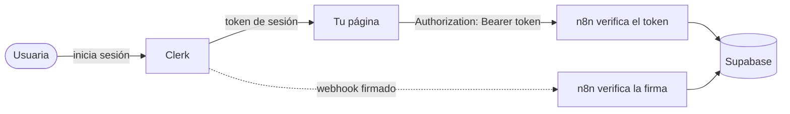

# Tu aplicación en Clerk

Creá una aplicación de Clerk para que tu proyecto tenga login de verdad, y encontrá las claves, el secreto de los webhooks y la clave pública con la que n8n verifica cada sesión.

| De un vistazo | |
|---|---|
| **Para quién es** | Para quien quiere que su proyecto tenga usuarias con cuenta (login con correo o con Google) y que n8n sepa quién pide cada cosa. |
| **Qué vas a lograr** | Una aplicación de Clerk con login andando, sus claves publicable y secreta, un webhook hacia n8n con su secreto y la clave pública en formato PEM. |
| **Tiempo estimado** | 20 minutos |
| **Qué necesitás** | Un correo (o una cuenta de Google o GitHub), tu n8n abierto y, si vas a guardar perfiles, tu proyecto de Supabase ([guía 04](04-cuenta-supabase.md)). |

## Qué es Clerk y cómo se conecta con n8n

Clerk resuelve el login completo: la pantalla para entrar, las sesiones y la lista de usuarias. En los proyectos de Nodo Cero lo usamos de dos maneras:



1. **La página manda el token de sesión a n8n.** Es un JWT firmado por Clerk. n8n lo verifica con la clave pública de tu aplicación y recién ahí responde (workflow [`21-clerk-api-protegida`](https://github.com/nodo-cero-bo/workflows/tree/main/20-clerk/21-clerk-api-protegida)).
2. **Clerk le avisa a n8n cuando pasa algo** (alguien se registra, cambia sus datos o borra su cuenta) con un webhook firmado. n8n verifica la firma y actualiza la tabla `perfiles` (workflow [`20-clerk-webhook-a-supabase`](https://github.com/nodo-cero-bo/workflows/tree/main/20-clerk/20-clerk-webhook-a-supabase)).

## Pasos

### 1. Creá tu cuenta y tu aplicación

1. Entrá a [dashboard.clerk.com/sign-up](https://dashboard.clerk.com/sign-up) y creá tu cuenta. El plan gratuito no pide tarjeta.
2. Creá una aplicación nueva: ponele un nombre (por ejemplo `Nodo Cero · mi proyecto`) y elegí cómo van a iniciar sesión tus usuarias, por ejemplo con correo y con Google.
3. Confirmá. Clerk arma una **instancia de desarrollo**: sus claves empiezan con `pk_test_` y `sk_test_`, funciona en `localhost` y alcanza de sobra para la hackathon. Para salir a producción, Clerk te pide un dominio propio.

### 2. Copiá la clave publicable y la secreta

En el panel de tu aplicación, entrá a la página **API keys**: ahí están las dos.

| Clave | Empieza con | Dónde va |
|---|---|---|
| **Publishable key** | `pk_test_` | En tu página web: carga la pantalla de login. No es secreta. |
| **Secret key** | `sk_test_` | En n8n y en ningún otro lado: le permite a n8n hablar con la Backend API de Clerk (por ejemplo, para invitar personas con [`22-clerk-invitaciones`](https://github.com/nodo-cero-bo/workflows/tree/main/20-clerk/22-clerk-invitaciones)). |

### 3. Copiá la clave pública para verificar sesiones (PEM)

En la misma página **API keys** está la **JWKS Public Key**. Copiá el formato PEM completo, con las líneas de inicio y fin:

```text
-----BEGIN PUBLIC KEY-----
MIIBIjANBgkqh...(varias líneas)...
-----END PUBLIC KEY-----
```

En n8n, la clave va en una credencial **JWT Auth**, la que pide el nodo **Verificar sesión de Clerk** del workflow `21-clerk-api-protegida`: **Key Type** `PEM Key`, la clave completa en **Public Key**, **Private Key** vacía y **Algorithm** `RS256`. Con esa clave, n8n comprueba tres cosas de cada token: que lo firmó tu aplicación (algoritmo RS256), que no venció (`exp` y `nbf`) y, si viene, que salió de tu página (`azp`).

> [!NOTE]
> La clave pública no es secreta: sirve para verificar, no para firmar. La que nunca se comparte es la **Secret key**.

### 4. Creá el webhook hacia n8n

1. En n8n, importá [`20-clerk-webhook-a-supabase`](https://github.com/nodo-cero-bo/workflows/tree/main/20-clerk/20-clerk-webhook-a-supabase), conectá tu credencial **Supabase API**, publicalo con **Publish** y copiá la **Production URL** de su nodo Webhook, **Recibir aviso de Clerk** (termina en `/webhook/clerk-usuarias`).
2. En Clerk, entrá a la página **Webhooks** y tocá **Add Endpoint**.
3. En **Endpoint URL**, pegá la URL de n8n.
4. En **Subscribe to events**, marcá `user.created`, `user.updated` y `user.deleted`.
5. Tocá **Create**. Clerk te lleva a la página del endpoint: copiá el **Signing Secret** (empieza con `whsec_`; quizás tengas que tocar el ojito para verlo).
6. En n8n, abrí el nodo **Configuración** del workflow 20, pegá ese secreto en `secreto_firma` y volvé a publicar.
7. Probalo: en la página del endpoint, pestaña **Testing**, elegí `user.created` y tocá **Send Example**. En **Message Attempts** tiene que aparecer **Succeeded**, y en n8n, una ejecución nueva en **Executions**.

<details>
<summary>Cómo funciona la firma de los webhooks (Svix)</summary>

Clerk manda sus webhooks a través de Svix. Cada pedido trae tres encabezados: `svix-id`, `svix-timestamp` y `svix-signature`. Para verificarlo:

1. Se arma el texto `svix-id.svix-timestamp.cuerpo`, con el cuerpo exacto que llegó.
2. Se calcula un HMAC SHA-256 de ese texto. La clave es lo que viene después de `whsec_`, decodificado desde base64.
3. El resultado, en base64, tiene que coincidir con alguna de las firmas de `svix-signature` (cada una viene con el prefijo `v1,`).
4. Además, se revisa que `svix-timestamp` sea reciente, para que nadie pueda reenviar un pedido viejo.

La firma se calcula sobre el cuerpo tal cual lo mandó Clerk, byte por byte: si se transforma antes de verificar, deja de coincidir. Como el mismo evento puede llegar más de una vez, conviene guardar con `upsert` (insertar o actualizar) y no con un insert a ciegas.

</details>

### 5. Probá el circuito completo

El repo de workflows trae [`clerk/app-ejemplo`](https://github.com/nodo-cero-bo/workflows/tree/main/clerk/app-ejemplo): una página HTML mínima que inicia sesión con Clerk, pide el token con `Clerk.session.getToken()` y llama a tu workflow 21 con `Authorization: Bearer <token>`. Los pasos para correrla en tu compu están en la guía de proyecto [App con login y datos](../proyectos/02-app-con-login-y-datos.md).

## Si algo falla

| Lo que ves | Qué probar |
|---|---|
| En **Message Attempts** aparece **Failed** | Fijate que el workflow 20 esté publicado y que la URL sea la de producción (`/webhook/`, no `/webhook-test/`). |
| n8n recibe el webhook pero dice que la firma no coincide | El **Signing Secret** es de otro endpoint, quedó incompleto o el cuerpo se modificó antes de verificar. Copiá el secreto de nuevo desde la página del endpoint. |
| El workflow 21 responde 401 | El token venció (duran poco: pedí uno nuevo con `getToken()` justo antes de cada llamada), la clave PEM de la credencial **JWT Auth** quedó incompleta o la dirección de tu página no está en `origenes_permitidos` (nodo **Leer el pedido**), que se compara con el `azp` del token. |
| El navegador muestra un error de CORS | En el nodo **Pedido a /mi-perfil** del workflow 21, revisá **Options** → **Allowed Origins (CORS)**: tiene que permitir la dirección de tu página, con el puerto y sin barra al final (la página de ejemplo usa `http://localhost:5500`). |
| La pantalla de login no aparece | La **Publishable key** está mal copiada o es de otra aplicación. |

## Para seguir

- Siguiente guía: [Core Wallet y Avalanche Fuji](06-core-wallet-y-fuji.md).
- Documentación oficial de Clerk: [Webhooks](https://clerk.com/docs/guides/development/webhooks/overview), [sincronizar datos con webhooks](https://clerk.com/docs/guides/development/webhooks/syncing), [verificar el JWT a mano](https://clerk.com/docs/guides/sessions/manual-jwt-verification), [tokens de sesión](https://clerk.com/docs/guides/sessions/session-tokens), [JavaScript quickstart](https://clerk.com/docs/js-frontend/getting-started/quickstart) e [invitaciones](https://clerk.com/docs/guides/users/inviting).
- De Svix: [cómo verificar la firma a mano](https://docs.svix.com/receiving/verifying-payloads/how-manual).

---

[Índice](../README.md) · Anterior: [Tu proyecto en Supabase](04-cuenta-supabase.md) · Siguiente: [Core Wallet y Avalanche Fuji](06-core-wallet-y-fuji.md)
