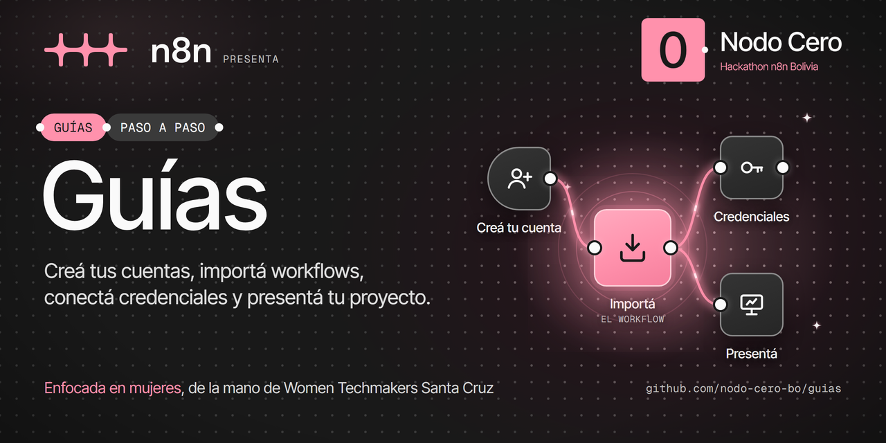
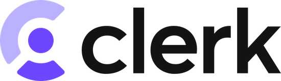
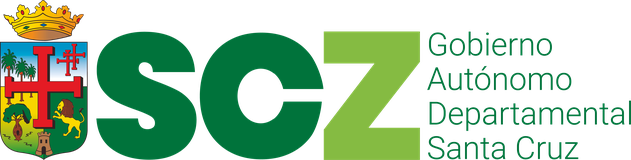

<p align="center">
  
</p>

<p align="center">
  <a href="https://github.com/nodo-cero-bo/guias/actions/workflows/auditar.yml"></a>
  
  
  <a href="LICENSE"></a>
</p>

<p align="center">
  <a href="https://nodo-cero-bo.github.io"><b>Página del evento</b></a> ·
  <a href="https://github.com/nodo-cero-bo/workflows">Workflows</a> ·
  <a href="https://github.com/nodo-cero-bo/proyectos">Proyectos</a> ·
  <a href="https://github.com/nodo-cero-bo/proyectos/issues/new?template=proyecto.yml">Registrá tu proyecto</a>
</p>

# Guías de Nodo Cero

Guías paso a paso para construir con n8n: crear tus cuentas, importar workflows, conectar credenciales, armar un proyecto completo, presentarlo y seguir después del sábado.

**Nodo Cero – Hackathon n8n Bolivia** es la hackathon de la comunidad n8n en Bolivia, enfocada en mujeres, de la mano de Women Techmakers Santa Cruz: sábado 21 de noviembre de 2026, en el Centro de Educación Ambiental (CEA) de Santa Cruz de la Sierra. Estas guías sirven para el día del evento y para seguir aprendiendo a tu ritmo. No hace falta haber usado n8n nunca: se aprende haciendo.

Los workflows que usan las guías están en el repo [**nodo-cero-bo/workflows**](https://github.com/nodo-cero-bo/workflows) y en el catálogo de la [**página del evento**](https://nodo-cero-bo.github.io), con el botón «Copiar workflow» para pegarlos directo en tu canvas.

## Empezá en tres pasos

1. **Creá tu cuenta de n8n Cloud** y recorré el editor: [guía 01](00-empezar/01-cuenta-n8n-cloud.md).
2. **Importá un workflow** de la colección (copiar y pegar, desde una URL o un archivo): [guía 02](00-empezar/02-importar-workflows.md).
3. **Conectá tus credenciales**, las llaves que n8n usa para hablar con otros servicios: [guía 03](00-empezar/03-credenciales.md).

Con eso andando, elegí una ruta.

## Elegí tu ruta

| Ruta | Es para vos si... | Terminás con |
|---|---|---|
| [Ruta inicial](#ruta-inicial) | Nunca usaste n8n y querés algo que funcione hoy. | Un formulario que guarda en una base de datos y una IA que ordena cada respuesta. |
| [Ruta IA](#ruta-ia) | Te interesan los agentes de IA. | Un asistente con enlace público que responde con tus documentos y recuerda la conversación. |
| [Ruta Web3 con Avalanche Fuji](#ruta-web3-con-avalanche-fuji) | Querés sumar blockchain a tu proyecto, aunque nunca hayas usado una wallet. | Una wallet en Fuji, tu primera transacción leída por n8n y un verificador de pagos, un agente o tu propio contrato. |
| [Ruta app con login y datos](#ruta-app-con-login-y-datos) | Alguien del equipo se anima con un poco de HTML. | Una página con login de Clerk, una API de n8n protegida y los datos en Supabase. |

Las rutas se cruzan: arrancá por una y tomá piezas de otra cuando las necesites.

### Ruta inicial

Para quien abre n8n por primera vez. Los primeros workflows no piden ninguna credencial.

1. [Tu cuenta de n8n Cloud](00-empezar/01-cuenta-n8n-cloud.md): el editor, tu primer workflow y las ejecuciones.
2. [Importar workflows](00-empezar/02-importar-workflows.md), empezando por [`01-hola-n8n`](https://github.com/nodo-cero-bo/workflows/tree/main/00-fundamentos/01-hola-n8n): datos, expresiones y decisiones.
3. Probá [`02-mi-primera-api`](https://github.com/nodo-cero-bo/workflows/tree/main/00-fundamentos/02-mi-primera-api) y [`04-formulario`](https://github.com/nodo-cero-bo/workflows/tree/main/00-fundamentos/04-formulario): tu primera API y tu primer formulario.
4. Abrí tus cuentas: [credenciales](00-empezar/03-credenciales.md), [Supabase](00-empezar/04-cuenta-supabase.md) y [Gemini](00-empezar/07-clave-gemini.md).
5. Tu proyecto: [Formularios inteligentes que guardan y clasifican](proyectos/05-formularios-inteligentes.md). Si tu equipo tiene una causa, seguí con [Impacto ambiental o social](proyectos/07-impacto-ambiental-o-social.md).

### Ruta IA

Para armar agentes que conversan, buscan en documentos y recuerdan.

1. Si todavía no la tenés, [tu cuenta de n8n Cloud](00-empezar/01-cuenta-n8n-cloud.md) y [cómo importar](00-empezar/02-importar-workflows.md).
2. [Tu clave de Gemini](00-empezar/07-clave-gemini.md) y tu primer agente con [`05-agente-ia`](https://github.com/nodo-cero-bo/workflows/tree/main/00-fundamentos/05-agente-ia).
3. [Tu proyecto en Supabase](00-empezar/04-cuenta-supabase.md): las tablas y la conexión Postgres para la memoria del agente.
4. Tu proyecto: [Asistente con IA para tu comunidad](proyectos/01-asistente-ia-para-tu-comunidad.md), con [`32-cargar-documentos-rag`](https://github.com/nodo-cero-bo/workflows/tree/main/30-supabase/32-cargar-documentos-rag) y [`33-agente-con-memoria-y-rag`](https://github.com/nodo-cero-bo/workflows/tree/main/30-supabase/33-agente-con-memoria-y-rag).
5. Para sumar: la clasificación con IA de [Formularios inteligentes](proyectos/05-formularios-inteligentes.md) o el asistente para un negocio de [Automatizá tu emprendimiento](proyectos/08-automatiza-tu-emprendimiento.md).

### Ruta Web3 con Avalanche Fuji

Fuji es la red de prueba de Avalanche: funciona igual que la principal, pero sus AVAX no tienen valor y se piden gratis. La hackathon tiene un track de Avalanche Fuji, con mención especial para los equipos que integren Fuji en su proyecto.

1. [Core Wallet y Avalanche Fuji](00-empezar/06-core-wallet-y-fuji.md): tu wallet, el modo testnet, AVAX de prueba en el faucet y tu primera transacción.
2. Importá [`10-fuji-estado-de-la-red`](https://github.com/nodo-cero-bo/workflows/tree/main/10-avalanche-fuji/10-fuji-estado-de-la-red) y [`11-fuji-saldo-wallet`](https://github.com/nodo-cero-bo/workflows/tree/main/10-avalanche-fuji/11-fuji-saldo-wallet): leen la red sin claves.
3. El desafío del día: [`12-fuji-leer-transaccion`](https://github.com/nodo-cero-bo/workflows/tree/main/10-avalanche-fuji/12-fuji-leer-transaccion), con el hash de tu transacción.
4. Tu proyecto: [Pagos verificables en Fuji](proyectos/03-pagos-verificables-en-fuji.md), [Agente Web3 que lee Fuji](proyectos/04-agente-web3-que-lee-fuji.md) o [Tu contrato en Fuji](proyectos/06-tu-contrato-en-fuji.md).
5. Todo lo de Avalanche y Team1 junto: [Recursos de Avalanche](avalanche/recursos.md).

| Llamado | Para qué |
|---|---|
| **[Descargá Core Wallet](https://core.app/download?utm_source=nodo-cero&utm_medium=github&utm_campaign=hackathon-n8n-bolivia-2026)** | La wallet de Avalanche, con modo testnet para pasar a Fuji. |
| **[Pedí AVAX de prueba en el faucet](https://build.avax.network/console/primary-network/faucet?utm_source=nodo-cero&utm_medium=github&utm_campaign=hackathon-n8n-bolivia-2026)** | Para probar pagos, contratos y workflows sin plata real. |
| **[Aprendé en Avalanche Academy](https://build.avax.network/academy?utm_source=nodo-cero&utm_medium=github&utm_campaign=hackathon-n8n-bolivia-2026)** | Cursos gratis con certificado, de Blockchain Fundamentals a Solidity. |
| **[Sumate a Team1 LATAM](https://www.team1.network/?utm_source=nodo-cero&utm_medium=github&utm_campaign=hackathon-n8n-bolivia-2026#waitlist)** | La comunidad de Avalanche, que apoya el track de Fuji. |
| **[Explorá tus transacciones](https://build.avax.network/explorer/fuji/c-chain?utm_source=nodo-cero&utm_medium=github&utm_campaign=hackathon-n8n-bolivia-2026)** | El explorador de Fuji: cada transacción, bloque y contrato, a la vista. |

### Ruta app con login y datos

El circuito de una app real: login, una API que verifica quién pide cada cosa y una base de datos. Clerk tiene una mención al mejor uso de Clerk.

1. [Tu proyecto en Supabase](00-empezar/04-cuenta-supabase.md): la URL, las claves y las tablas de Nodo Cero.
2. [Tu aplicación en Clerk](00-empezar/05-cuenta-clerk.md): las claves, el webhook firmado y la clave pública en formato PEM.
3. [Credenciales](00-empezar/03-credenciales.md): cuáles van en n8n y cuáles nunca salen de ahí.
4. Tu proyecto: [App con login y datos](proyectos/02-app-con-login-y-datos.md), con [`20-clerk-webhook-a-supabase`](https://github.com/nodo-cero-bo/workflows/tree/main/20-clerk/20-clerk-webhook-a-supabase), [`21-clerk-api-protegida`](https://github.com/nodo-cero-bo/workflows/tree/main/20-clerk/21-clerk-api-protegida) y la página de [`clerk/app-ejemplo`](https://github.com/nodo-cero-bo/workflows/tree/main/clerk/app-ejemplo).
5. Para sumar: invitaciones por correo con [`22-clerk-invitaciones`](https://github.com/nodo-cero-bo/workflows/tree/main/20-clerk/22-clerk-invitaciones), o pagos verificados detrás del login con [`41-pagos-fuji-con-login`](https://github.com/nodo-cero-bo/workflows/tree/main/40-proyectos/41-pagos-fuji-con-login) ([guía](proyectos/03-pagos-verificables-en-fuji.md)).

## Todas las guías

### Para empezar

| # | Guía | Qué hacés | Tiempo |
|---|---|---|---|
| 01 | [Tu cuenta de n8n Cloud](00-empezar/01-cuenta-n8n-cloud.md) | Creás tu cuenta de prueba, recorrés el editor, armás tu primer workflow y leés una ejecución. | 20 min |
| 02 | [Importar los workflows](00-empezar/02-importar-workflows.md) | Traés un workflow de tres formas (pegar, URL o archivo), conectás credenciales y lo probás. | 10 min por workflow |
| 03 | [Credenciales](00-empezar/03-credenciales.md) | Creás y probás credenciales, sabés cuál pide cada workflow y cómo cuidarlas. | 10 min |
| 04 | [Tu proyecto en Supabase](00-empezar/04-cuenta-supabase.md) | Creás el proyecto, cargás las tablas con el SQL Editor y conectás la base a n8n, también como memoria del agente. | 25 min |
| 05 | [Tu aplicación en Clerk](00-empezar/05-cuenta-clerk.md) | Creás la aplicación, copiás las claves, configurás el webhook con su secreto y la clave pública PEM. | 20 min |
| 06 | [Core Wallet y Avalanche Fuji](00-empezar/06-core-wallet-y-fuji.md) | Instalás Core, guardás tu frase de recuperación, pasás a Fuji, pedís AVAX de prueba y mirás tu transacción. | 20 min |
| 07 | [Tu clave de Gemini](00-empezar/07-clave-gemini.md) | Sacás una clave gratis en Google AI Studio y la conectás a tu primer agente. Con la alternativa de OpenAI. | 10 min |

### Guías de proyecto

Cada una junta varios workflows en algo que resuelve un problema real y termina con cómo presentarlo en la demo. Más detalle en el [índice de proyectos](proyectos/README.md).

| # | Proyecto | Arranca con | Nivel |
|---|---|---|---|
| 01 | [Asistente con IA para tu comunidad](proyectos/01-asistente-ia-para-tu-comunidad.md) | `05`, `32`, `33` | Inicial a intermedio |
| 02 | [App con login y datos](proyectos/02-app-con-login-y-datos.md) | `20`, `21`, `clerk/app-ejemplo` | Avanzado |
| 03 | [Pagos verificables en Avalanche Fuji](proyectos/03-pagos-verificables-en-fuji.md) | `12`, `13`, `41` | Inicial a avanzado |
| 04 | [Agente Web3 que lee Fuji](proyectos/04-agente-web3-que-lee-fuji.md) | `40`, `15`, `16` | Intermedio |
| 05 | [Formularios inteligentes que guardan y clasifican](proyectos/05-formularios-inteligentes.md) | `04`, `30`, `34` | Inicial a intermedio |
| 06 | [Tu contrato en Fuji y n8n escuchando sus eventos](proyectos/06-tu-contrato-en-fuji.md) | `16`, `avalanche/contratos` | Avanzado |
| 07 | [Impacto ambiental o social: reportes ciudadanos](proyectos/07-impacto-ambiental-o-social.md) | `30`, `34` | Intermedio |
| 08 | [Automatizá tu emprendimiento](proyectos/08-automatiza-tu-emprendimiento.md) | `30`, `31`, `32`, `33` | Inicial a intermedio |

Los números son los ids de los workflows del repo [nodo-cero-bo/workflows](https://github.com/nodo-cero-bo/workflows): cada guía los enlaza a su carpeta.

### Para pensar, presentar y seguir

| Guía | Para qué |
|---|---|
| [Banco de ideas](ideas.md) | Ideas por área (educación, salud, ambiente, emprendimiento, comunidad, finanzas y Web3), cada una con los workflows para arrancar. |
| [Cómo presentar tu proyecto](presentar.md) | Problema, solución, demo en vivo y qué sigue. Con un guion para completar, una lista para revisar y un plan B. |
| [Seguir construyendo](seguir-construyendo.md) | Guardar tus workflows, publicarlos en tu GitHub, documentarlos, registrar el proyecto y seguir aprendiendo. |
| [Recursos de Avalanche](avalanche/recursos.md) | Core Wallet, faucet, explorador, Avalanche Academy, Team1 y la documentación de la C-Chain. |

## Cómo están armadas

Todas las guías siguen la misma forma, para que sepas dónde buscar:

1. **De un vistazo**: para quién es, qué vas a lograr, el tiempo estimado y qué necesitás antes de empezar.
2. **Pasos** numerados, de a uno, con los nombres de los botones tal como aparecen en cada herramienta (en inglés, como los vas a ver en pantalla).
3. **Si algo falla**: una tabla con lo que ves y qué probar.
4. **Para seguir**: la siguiente guía y la documentación oficial.

Lo opcional viene plegado: tocá el título para abrirlo. Las guías de proyecto suman **Cómo presentarlo en la demo**.

Las pantallas de n8n Cloud, Supabase, Clerk y Core cambian cada tanto. Si un botón no está exactamente donde dice la guía, buscá el nombre de la sección (por ejemplo, **API keys** o **Webhooks**) y seguí desde ahí.

## Tres cuidados

- **Tus credenciales son tuyas.** Cada persona conecta las suyas en su n8n. Ninguna clave va en una nota, una captura, un chat ni un commit.
- **Nada de datos personales.** En los formularios, los documentos para la IA y la demo, usá datos inventados o públicos.
- **La frase de recuperación es la wallet.** Nadie de la organización ni de la mentoría te la va a pedir. Usá una wallet nueva, separada de cualquiera con plata real.

<details>
<summary>La agenda del sábado 21 de noviembre</summary>

| Hora | Qué pasa |
|---|---|
| 08:00 | Acreditación y café |
| 12:30 | Almuerzo, con el apoyo de Clerk |
| 14:30 | Refrigerio |
| 15:00 | Presentaciones |
| 15:45 | Cierre, menciones y foto grupal |
| 16:00 | Fin |

Equipos de hasta cuatro personas. Antes de presentar, registrá tu proyecto en la [vitrina](https://github.com/nodo-cero-bo/proyectos/issues/new?template=proyecto.yml) y repasá [cómo presentar](presentar.md).

</details>

## Sumá o corregí algo

Si una guía tiene un paso que ya no coincide con la pantalla, un enlace roto o algo que se puede explicar mejor, abrí un issue o mandá un pull request.

Antes de mandarlo, corré el auditor de las guías. Revisa las reglas de texto, la estructura de cada guía, los enlaces internos y los enlaces al repo de workflows (necesita Node 18 o más nuevo):

```bash
node tools/auditar_guias.mjs                 # reglas, estructura y enlaces internos
node tools/auditar_guias.mjs --red           # además, prueba en vivo cada enlace externo
node tools/auditar_guias.mjs --workflows ../workflows   # además, confirma que existan las carpetas de los workflows
```

El mismo auditor corre en cada push con GitHub Actions ([`.github/workflows/auditar.yml`](.github/workflows/auditar.yml)).

## Con quiénes lo hacemos

<p align="center"><sub>PRESENTA</sub><br><br>
  <a href="https://n8n.io"><picture><source media="(prefers-color-scheme: dark)" srcset="https://raw.githubusercontent.com/nodo-cero-bo/guias/main/assets/aliados/n8n-oscuro.png"></picture></a>
</p>

<p align="center"><sub>CON EL APOYO DE</sub><br><br>
  <a href="https://supabase.com"><picture><source media="(prefers-color-scheme: dark)" srcset="https://raw.githubusercontent.com/nodo-cero-bo/guias/main/assets/aliados/supabase-oscuro.png"></picture></a>
  &nbsp;&nbsp;&nbsp;&nbsp;&nbsp;&nbsp;
  <a href="https://clerk.com"><picture><source media="(prefers-color-scheme: dark)" srcset="https://raw.githubusercontent.com/nodo-cero-bo/guias/main/assets/aliados/clerk-oscuro.png"></picture></a>
  &nbsp;&nbsp;&nbsp;&nbsp;&nbsp;&nbsp;
  <a href="https://www.team1.network/?utm_source=nodo-cero&utm_medium=github&utm_campaign=hackathon-n8n-bolivia-2026"><picture><source media="(prefers-color-scheme: dark)" srcset="https://raw.githubusercontent.com/nodo-cero-bo/guias/main/assets/aliados/team1-oscuro.png"></picture></a>
  &nbsp;&nbsp;&nbsp;&nbsp;&nbsp;&nbsp;
  <a href="https://www.aspireleaders.org"><picture><source media="(prefers-color-scheme: dark)" srcset="https://raw.githubusercontent.com/nodo-cero-bo/guias/main/assets/aliados/aspire-oscuro.png"></picture></a>
</p>

<p align="center"><sub>EN COLABORACIÓN CON</sub><br><br>
  <a href="https://www.instagram.com/wtmsantacruz/"><picture><source media="(prefers-color-scheme: dark)" srcset="https://raw.githubusercontent.com/nodo-cero-bo/guias/main/assets/aliados/wtm-oscuro.png"></picture></a>
</p>

<p align="center"><sub>SEDE</sub><br><br>
  <a href="https://www.santacruz.gob.bo"><picture><source media="(prefers-color-scheme: dark)" srcset="https://raw.githubusercontent.com/nodo-cero-bo/guias/main/assets/aliados/gobierno-oscuro.png"></picture></a>
</p>

## Licencia y marcas

Las guías de este repo están bajo la licencia [Creative Commons Atribución 4.0 Internacional (CC BY 4.0)](LICENSE): podés copiarlas, adaptarlas y compartirlas para cualquier fin, citando a Nodo Cero como fuente, enlazando la licencia e indicando si hiciste cambios ([resumen de la licencia en español](https://creativecommons.org/licenses/by/4.0/deed.es)). El auditor de [`tools/`](tools) es código bajo licencia MIT, como indica su encabezado.

n8n, Supabase, Clerk, Avalanche, Core, Team1, Aspire Institute, Google Gemini, OpenAI, GitHub, Women Techmakers, el Gobierno Autónomo Departamental de Santa Cruz y los demás nombres y logos que aparecen en estas guías son marcas de sus dueños. Los logos de la cabecera y de esta página son los oficiales de cada marca, se usan para nombrar a quienes hacen posible el evento y no entran en la licencia de este repo.
