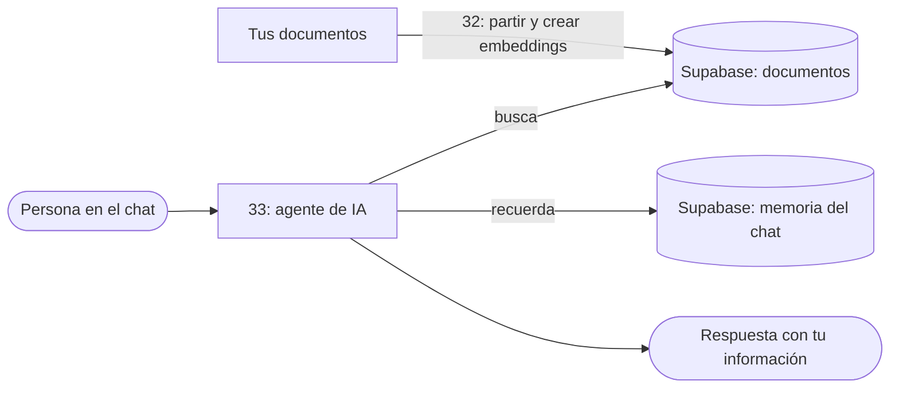

# Asistente con IA para tu comunidad

Un chat público que responde preguntas con la información de tus propios documentos y recuerda la conversación: para un centro de estudiantes, una organización, un club o un emprendimiento.

| De un vistazo | |
|---|---|
| **Para quién es** | Para equipos que reciben siempre las mismas preguntas (horarios, requisitos, cómo inscribirse, qué hace la organización) y quieren que alguien conteste a cualquier hora. Sirve para quien nunca armó un agente y para quien quiere pasar de un chat genérico a uno que sabe de lo suyo. |
| **Qué vas a lograr** | Un agente de IA con un enlace público para compartir, que busca en tus documentos antes de responder, dice cuando no sabe y recuerda lo que se habló. |
| **Tiempo estimado** | 2 a 3 horas |
| **Qué necesitás** | Tu n8n ([guía 01](../00-empezar/01-cuenta-n8n-cloud.md)), una clave de Gemini ([guía 07](../00-empezar/07-clave-gemini.md)), un proyecto de Supabase con las tablas de Nodo Cero y las credenciales **Supabase API** y **Postgres** ([guía 04](../00-empezar/04-cuenta-supabase.md)), y uno o dos documentos públicos de tu comunidad (PDF o texto). |
| **Workflows** | [`05-agente-ia`](https://github.com/nodo-cero-bo/workflows/tree/main/00-fundamentos/05-agente-ia) · [`32-cargar-documentos-rag`](https://github.com/nodo-cero-bo/workflows/tree/main/30-supabase/32-cargar-documentos-rag) · [`33-agente-con-memoria-y-rag`](https://github.com/nodo-cero-bo/workflows/tree/main/30-supabase/33-agente-con-memoria-y-rag) |

Palabras de esta guía, explicadas con un ejemplo en el [glosario](../glosario.md): [agente](../glosario.md#agente), [RAG](../glosario.md#rag), [embeddings](../glosario.md#embeddings), [memoria](../glosario.md#memoria) y [mensaje de sistema](../glosario.md#prompt-y-mensaje-de-sistema).

## La idea

Un modelo de IA sabe mucho del mundo, pero nada de tu comunidad. La técnica para que responda con tu información se llama **RAG** (generación aumentada con búsqueda): antes de contestar, el agente busca en tus documentos los pedacitos que más se parecen a la pregunta y responde con eso.



## Pasos

### 1. Hacé andar el agente simple

1. Importá [`05-agente-ia`](https://github.com/nodo-cero-bo/workflows/tree/main/00-fundamentos/05-agente-ia) ([cómo importar](../00-empezar/02-importar-workflows.md)).
2. Conectá tu credencial **Google Gemini(PaLM) Api** en el nodo **Modelo Gemini**.
3. Tocá **Open chat**, abajo del canvas, y conversá un rato.
4. Abrí el nodo **Agente de IA** y buscá el mensaje de sistema: es el texto que le dice al agente quién es y cómo responder. Reescribilo para tu comunidad. Por ejemplo:

   ```text
   Sos el asistente del Centro de Estudiantes de Ingeniería.
   Respondé en español, con voseo, en frases cortas y amables.
   Si no sabés algo, decilo y sugerí escribir a la directiva.
   No inventes fechas, montos ni nombres.
   ```

5. Probá de nuevo. Fijate cómo cambia el tono con cada ajuste.

### 2. Prepará la base en Supabase

1. Si todavía no lo hiciste, corré el SQL de [`supabase/sql`](https://github.com/nodo-cero-bo/workflows/tree/main/supabase/sql) en el **SQL Editor** de tu proyecto ([guía 04, paso 4](../00-empezar/04-cuenta-supabase.md#4-cargá-las-tablas-de-nodo-cero-con-el-sql-editor)).
2. En **Table Editor**, confirmá que existe la tabla `documentos`. Ahí van a vivir los pedacitos de tus documentos con sus embeddings.

### 3. Cargá tus documentos

1. Importá [`32-cargar-documentos-rag`](https://github.com/nodo-cero-bo/workflows/tree/main/30-supabase/32-cargar-documentos-rag) y conectá las credenciales que pide: **Google Gemini(PaLM) Api** (para los embeddings) y **Supabase API**.
2. Leé la nota grande del workflow: dice qué tipos de archivo acepta.
3. Tocá **Execute workflow** (ejecutar el workflow): se abre el formulario de prueba. Subí tu primer documento.
4. Volvé a Supabase, a la tabla `documentos`: tiene que haber filas nuevas, una por cada pedacito.
5. Repetí con los demás documentos.

> [!IMPORTANT]
> Subí nada más que información pública: reglamentos, preguntas frecuentes, horarios, la descripción de la organización. Nada de listas de personas, teléfonos ni datos de salud. Todo lo que cargues lo puede repetir el agente.

### 4. Armá el agente con memoria y búsqueda

1. Importá [`33-agente-con-memoria-y-rag`](https://github.com/nodo-cero-bo/workflows/tree/main/30-supabase/33-agente-con-memoria-y-rag).
2. Conectá **Google Gemini(PaLM) Api**, **Supabase API** (para buscar en `documentos`) y **Postgres** (para la memoria, con el **Session pooler** de Supabase: [guía 04, paso 5](../00-empezar/04-cuenta-supabase.md#5-conectá-la-memoria-del-agente-postgres)).
3. Tocá **Open chat** y preguntá algo que esté en tus documentos y que el modelo no pueda saber por su cuenta.
4. Mirá la ejecución: en los registros del agente vas a ver cuándo llamó a la herramienta de búsqueda y qué pedacitos le devolvió.
5. Hacé una pregunta de seguimiento («¿y a qué hora?») para comprobar que recuerda la conversación.

### 5. Ajustá el mensaje de sistema

Copiá en el agente 33 lo que aprendiste en el paso 1 y sumale reglas para que use tus documentos:

```text
Antes de responder, buscá en los documentos con tu herramienta.
Respondé con lo que encuentres ahí. Si no aparece, decí que no tenés ese dato.
Cuando uses un documento, nombrá de cuál sale la respuesta.
```

Probalo con preguntas que sí están en los documentos y con preguntas que no: lo segundo importa tanto como lo primero.

### 6. Publicalo y compartilo

1. En el nodo **Chat Trigger** (el que empieza el workflow), activá **Make Chat Publicly Available**.
2. Tocá **Publish**.
3. Copiá la URL pública del chat que muestra el nodo y abrila en tu celular.
4. Si querés, generá un código QR con esa URL para la demo.

<details>
<summary>Hacelo tuyo: ideas para sumar</summary>

- **Botón de ayuda humana**: si la persona escribe «hablar con alguien», que el agente guarde la consulta en una tabla de Supabase para que la directiva la conteste.
- **Formulario para cargar documentos nuevos**: publicá el workflow 32 para que la organización suba sus documentos sin tocar n8n.
- **Bienvenida en el chat**: en las opciones del **Chat Trigger** podés escribir un mensaje inicial con tres preguntas de ejemplo.
- **Otro modelo**: cambiá Gemini por OpenAI siguiendo la [alternativa de la guía 07](../00-empezar/07-clave-gemini.md#alternativa-openai).

</details>

## Cómo presentarlo en la demo

1. **El problema, en una frase y con un ejemplo real**: «Cada semestre la directiva contesta las mismas cuarenta preguntas por chat».
2. **La solución**: un asistente que contesta con los documentos de la organización, a cualquier hora.
3. **Demo en vivo**:
   - Abrí el chat público en el celular (proyectado o en la pantalla) y hacé una pregunta cuya respuesta esté en un documento.
   - Hacé una pregunta de seguimiento para mostrar la memoria.
   - Hacé una pregunta que no esté en los documentos y mostrá que el agente dice que no sabe en vez de inventar.
   - Pasá a n8n y mostrá la ejecución: el agente, la búsqueda en Supabase y los pedacitos que encontró.
4. **Qué sigue**: qué documentos sumarían, quién lo usaría y cómo medirían si ayuda.

Tené a mano un plan B: capturas del chat respondiendo bien, por si la red del lugar falla.

## Si algo falla

| Lo que ves | Qué probar |
|---|---|
| El agente responde cosas genéricas y no usa tus documentos | Revisá que la tabla `documentos` tenga filas, que el agente tenga conectada la herramienta de búsqueda y que el mensaje de sistema le pida buscar primero. |
| La búsqueda no encuentra nada aunque hay filas | Usá el mismo modelo de embeddings en el workflow 32 y en el 33: la columna de la tabla tiene un tamaño fijo y los números de modelos distintos no se pueden comparar. |
| Error `429` o de cuota | Llegaste al límite del nivel gratuito de Gemini. Esperá un minuto y probá de nuevo, y cargá los documentos de a uno. |
| La memoria falla con un error de conexión | Revisá la credencial **Postgres**: host del **Session pooler**, puerto `5432`, usuario `postgres.<referencia>` y **Ignore SSL Issues (Insecure)** activado ([guía 04](../00-empezar/04-cuenta-supabase.md#si-algo-falla)). |
| El enlace público del chat no abre | El workflow tiene que estar publicado y **Make Chat Publicly Available**, activado. |
| El agente mezcla conversaciones de distintas personas | La memoria se separa por sesión: cada navegador abre la suya. Si probás desde el mismo navegador, abrí una ventana privada. |

## Para seguir

- Documentación oficial: [AI Agent](https://docs.n8n.io/integrations/builtin/cluster-nodes/root-nodes/n8n-nodes-langchain.agent/), [Chat Trigger](https://docs.n8n.io/integrations/builtin/core-nodes/n8n-nodes-langchain.chattrigger/), [Supabase Vector Store](https://docs.n8n.io/integrations/builtin/cluster-nodes/root-nodes/n8n-nodes-langchain.vectorstoresupabase/), [Postgres Chat Memory](https://docs.n8n.io/integrations/builtin/cluster-nodes/sub-nodes/n8n-nodes-langchain.memorypostgreschat/), [IA en n8n](https://docs.n8n.io/build/integrate-ai) e [IA y vectores en Supabase](https://supabase.com/docs/guides/ai).
- Si querés que el asistente también lea Fuji, mirá el [Agente Web3](04-agente-web3-que-lee-fuji.md).
- Para un emprendimiento, combinalo con [Automatizá tu emprendimiento](08-automatiza-tu-emprendimiento.md).

---

[Guías de proyecto](README.md) · Siguiente: [App con login y datos](02-app-con-login-y-datos.md)
