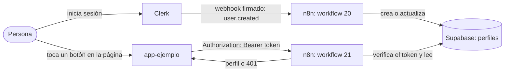

# App con login y datos

Una página donde las personas inician sesión con Clerk, n8n verifica quién pide cada cosa y responde con sus datos guardados en Supabase. El circuito completo de una app real: login, API protegida y base de datos.

| De un vistazo | |
|---|---|
| **Para quién es** | Para equipos con alguien que se anime a tocar un poco de HTML, y para quien quiere entender cómo se protege una API de verdad. Si nunca lo hiciste, seguí los pasos tal cual: el código ya está escrito. |
| **Qué vas a lograr** | Una página con login, perfiles que se sincronizan solos en Supabase cuando alguien se registra, y una API en n8n que responde 401 a quien no inició sesión. |
| **Tiempo estimado** | 2 a 3 horas |
| **Qué necesitás** | Tu n8n, una aplicación de Clerk ([guía 05](../00-empezar/05-cuenta-clerk.md)), un proyecto de Supabase con las tablas de Nodo Cero ([guía 04](../00-empezar/04-cuenta-supabase.md)), un editor de texto (VS Code o el que uses) y Python o Node.js en tu compu para servir la página. |
| **Workflows** | [`20-clerk-webhook-a-supabase`](https://github.com/nodo-cero-bo/workflows/tree/main/20-clerk/20-clerk-webhook-a-supabase) · [`21-clerk-api-protegida`](https://github.com/nodo-cero-bo/workflows/tree/main/20-clerk/21-clerk-api-protegida) · [`clerk/app-ejemplo`](https://github.com/nodo-cero-bo/workflows/tree/main/clerk/app-ejemplo) |

Clerk apoya Nodo Cero y tiene una mención al mejor uso de Clerk: este proyecto es un buen punto de partida.

## La idea



Dos caminos que se encuentran en la misma tabla:

- **Clerk avisa a n8n** cada vez que alguien se registra, cambia sus datos o borra su cuenta. n8n verifica la firma del aviso y mantiene al día la tabla `perfiles`.
- **La página le pregunta a n8n** con el token de sesión de Clerk. n8n verifica el token con la clave pública de tu aplicación y, si es válido, devuelve el perfil.

## Pasos

### 1. Prepará Supabase y Clerk

1. En Supabase, corré el SQL de [`supabase/sql`](https://github.com/nodo-cero-bo/workflows/tree/main/supabase/sql) y confirmá que existe la tabla `perfiles` ([guía 04](../00-empezar/04-cuenta-supabase.md)).
2. En n8n, creá la credencial **Supabase API**.
3. En Clerk, creá tu aplicación y tené a mano la **Publishable key** y la **JWKS Public Key** en formato PEM ([guía 05, pasos 1 a 3](../00-empezar/05-cuenta-clerk.md#pasos)).

### 2. Sincronizá los perfiles (workflow 20)

1. Importá [`20-clerk-webhook-a-supabase`](https://github.com/nodo-cero-bo/workflows/tree/main/20-clerk/20-clerk-webhook-a-supabase) y conectá **Supabase API**.
2. Publicalo con **Publish** y copiá la **Production URL** de su nodo Webhook, **Recibir aviso de Clerk** (termina en `/webhook/clerk-usuarias`).
3. En Clerk, página **Webhooks**, creá el endpoint con esa URL y los eventos `user.created`, `user.updated` y `user.deleted` ([guía 05, paso 4](../00-empezar/05-cuenta-clerk.md#4-creá-el-webhook-hacia-n8n)).
4. Copiá el **Signing Secret** (`whsec_...`) y pegalo en el nodo **Configuración** del workflow, en `secreto_firma`. Volvé a publicar.
5. En Clerk, pestaña **Testing** del endpoint, mandá un `user.created` de ejemplo. En n8n tiene que aparecer una ejecución exitosa y en Supabase, una fila en `perfiles`.

### 3. Protegé tu API (workflow 21)

1. Importá [`21-clerk-api-protegida`](https://github.com/nodo-cero-bo/workflows/tree/main/20-clerk/21-clerk-api-protegida) y conectá **Supabase API** en **Buscar perfil**.
2. La clave pública PEM va en una credencial, no en el workflow. En el nodo **Verificar sesión de Clerk**, creá una credencial **JWT Auth**: **Key Type** `PEM Key`, pegá la clave completa (con las líneas `BEGIN` y `END`) en **Public Key**, dejá **Private Key** vacía y elegí **Algorithm** `RS256`.
3. Revisá la dirección desde donde vas a abrir la página. El workflow ya trae `http://localhost:5500`, la de la página de ejemplo, en dos lugares: en **Pedido a /mi-perfil** → **Options** → **Allowed Origins (CORS)**, y en **Leer el pedido** → `origenes_permitidos`. Si usás otra, cambiala en los dos, igual y sin barra al final.
4. Publicalo con **Publish** y copiá la **Production URL** del nodo **Pedido a /mi-perfil** (termina en `/webhook/mi-perfil`).
5. Probá que rechaza a quien no inició sesión. Desde la terminal (en Windows, `curl.exe`):

   ```bash
   curl -i "https://tu-nombre.app.n8n.cloud/webhook/mi-perfil"
   ```

   Tiene que responder `401`. Eso es lo que querés: sin token, no hay datos.

### 4. Corré la página de ejemplo

1. Descargá la carpeta [`clerk/app-ejemplo`](https://github.com/nodo-cero-bo/workflows/tree/main/clerk/app-ejemplo) (o el repo entero con **Code**, **Download ZIP**) y abrí su README.
2. Al principio del script de `index.html`, completá los dos datos: `PUBLISHABLE_KEY` con tu **Publishable key** de Clerk y `URL_MI_PERFIL` con la **Production URL** del workflow 21.
3. Serví la carpeta en el puerto 5500, el que el workflow 21 ya tiene permitido. Abrí una terminal dentro de la carpeta y usá una de estas opciones (o la extensión **Live Server** de VS Code, que usa el mismo puerto):

   ```bash
   # con Python
   python -m http.server 5500

   # o con Node.js
   npx serve -l 5500
   ```

4. Abrí `http://localhost:5500` en el navegador. No la abras con doble clic sobre el archivo: Clerk necesita que la página venga de una dirección `http`.

### 5. Probá el circuito completo

1. En la página, tocá **Iniciar sesión** y registrate con una cuenta nueva.
2. En n8n, mirá **Executions** del workflow 20: llegó el `user.created`. En Supabase, apareció tu perfil.
3. En la página, tocá **Ver mi perfil**. La página manda tu token y el workflow 21 responde `200` con tu perfil.
4. Tocá **Probar sin token**: la página llama a la API sin la sesión y la respuesta tiene que ser `401`.

<details>
<summary>Hacelo tuyo: ideas para sumar</summary>

- **Datos propios de cada persona**: sumá una tabla (por ejemplo, `ideas`) y una ruta en n8n que devuelva nada más que las filas de quien pide, usando el id de usuaria que viene en el token (`sub`).
- **Invitaciones**: con [`22-clerk-invitaciones`](https://github.com/nodo-cero-bo/workflows/tree/main/20-clerk/22-clerk-invitaciones), invitá a tu equipo o a quienes van a probar la app, por correo, desde n8n.
- **Pagos verificados con login**: el workflow [`41-pagos-fuji-con-login`](https://github.com/nodo-cero-bo/workflows/tree/main/40-proyectos/41-pagos-fuji-con-login) usa este mismo circuito para registrar pagos en Fuji ([guía 03](03-pagos-verificables-en-fuji.md)).
- **Publicar la página**: con GitHub Pages, y sumando esa dirección a CORS y a tu aplicación de Clerk ([Seguir construyendo](../seguir-construyendo.md#4-documentalo)).

</details>

## Cómo presentarlo en la demo

1. **El problema**: «Nuestra app necesita saber quién es cada persona sin que armemos un sistema de contraseñas».
2. **La solución**: login con Clerk, una API en n8n que verifica cada pedido y los datos en Supabase.
3. **Demo en vivo**:
   - Registrá una cuenta nueva en la página, en vivo.
   - Mostrá cómo aparece el perfil en Supabase segundos después, gracias al webhook.
   - Tocá el botón que llama a la API y mostrá la respuesta con el perfil.
   - Tocá **Probar sin token** (o usá el `curl` del paso 3) y mostrá el `401`: la API no le da datos a cualquiera.
   - En n8n, mostrá dónde se verifica la firma del webhook y dónde se verifica el token.
4. **Qué sigue**: qué datos guardaría tu app y quién la usaría.

Antes de la demo, registrá una cuenta de prueba que funcione, por si el correo de confirmación tarda.

## Si algo falla

| Lo que ves | Qué probar |
|---|---|
| El webhook de Clerk falla (**Failed**) | El workflow 20 tiene que estar publicado y la URL tiene que ser la de producción (`/webhook/`). |
| n8n dice que la firma no coincide | El **Signing Secret** es de otro endpoint o quedó incompleto. Copialo de nuevo. |
| La API responde 401 con la sesión iniciada | El token vence rápido: la página tiene que pedir uno nuevo antes de cada llamada. Revisá también que la clave PEM de la credencial **JWT Auth** esté completa y sea de esta aplicación de Clerk, y que la dirección de la página esté en `origenes_permitidos` (nodo **Leer el pedido**). |
| El navegador muestra un error de CORS | En el nodo **Pedido a /mi-perfil** del workflow 21, **Allowed Origins (CORS)** tiene que incluir la dirección exacta de tu página, con el puerto y sin barra al final. |
| La API responde 404 («todavía no hay un perfil») | La sesión está bien, falta tu fila: te registraste antes de configurar el webhook. Cambiá algo de tu perfil en la página (o desde el panel de Clerk) para que llegue un `user.updated`. |
| La pantalla de login no aparece | La **Publishable key** está mal copiada, o abriste el archivo con doble clic en vez de usar el servidor local. |

## Para seguir

- Documentación de Clerk: [verificar el JWT a mano](https://clerk.com/docs/guides/sessions/manual-jwt-verification), [tokens de sesión](https://clerk.com/docs/guides/sessions/session-tokens), [sincronizar datos con webhooks](https://clerk.com/docs/guides/development/webhooks/syncing) y el [JavaScript quickstart](https://clerk.com/docs/js-frontend/getting-started/quickstart).
- Documentación de n8n: [Webhook](https://docs.n8n.io/integrations/builtin/core-nodes/n8n-nodes-base.webhook/) y [Respond to Webhook](https://docs.n8n.io/integrations/builtin/core-nodes/n8n-nodes-base.respondtowebhook/).
- En Supabase, cómo [usar Clerk como proveedor de login](https://supabase.com/docs/guides/auth/third-party/clerk), para cuando quieras que la base también reconozca a cada persona.

---

[Guías de proyecto](README.md) · Anterior: [Asistente con IA](01-asistente-ia-para-tu-comunidad.md) · Siguiente: [Pagos verificables en Fuji](03-pagos-verificables-en-fuji.md)
