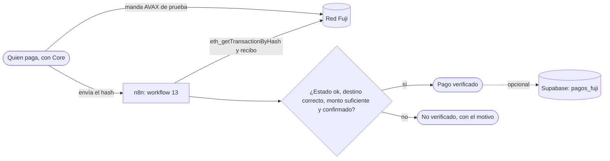

# Pagos verificables en Avalanche Fuji

Un verificador de pagos: alguien paga con AVAX de prueba, manda el hash de su transacción y n8n confirma en la red Fuji que el pago llegó a la dirección correcta, por el monto justo, antes de dar el pedido por pagado.

| De un vistazo | |
|---|---|
| **Para quién es** | Para equipos que quieren sumar Web3 con un caso que cualquiera entiende: cobrar y comprobar el pago sin depender de una captura de pantalla. Arranca simple (leer una transacción) y crece hasta una app con login. |
| **Qué vas a lograr** | Leer cualquier transacción de Fuji desde n8n, verificar un pago con reglas claras (estado, destino, monto y confirmaciones) y, si querés, registrarlo en Supabase detrás de un login. |
| **Tiempo estimado** | 1 hora para leer y verificar; 2 a 3 horas con registro y login. |
| **Qué necesitás** | Tu n8n y Core Wallet en Fuji con AVAX de prueba ([guía 06](../00-empezar/06-core-wallet-y-fuji.md)). Para registrar pagos: Supabase ([guía 04](../00-empezar/04-cuenta-supabase.md)). Para el login: Clerk ([guía 05](../00-empezar/05-cuenta-clerk.md)). |
| **Workflows** | [`12-fuji-leer-transaccion`](https://github.com/nodo-cero-bo/workflows/tree/main/10-avalanche-fuji/12-fuji-leer-transaccion) · [`13-fuji-verificar-pago`](https://github.com/nodo-cero-bo/workflows/tree/main/10-avalanche-fuji/13-fuji-verificar-pago) · [`41-pagos-fuji-con-login`](https://github.com/nodo-cero-bo/workflows/tree/main/40-proyectos/41-pagos-fuji-con-login) |

Palabras de esta guía, explicadas con un ejemplo en el [glosario](../glosario.md): [transacción](../glosario.md#transacción), [hash](../glosario.md#hash), [wei](../glosario.md#avax-y-wei), [confirmaciones](../glosario.md#bloque-y-confirmaciones) y [explorador](../glosario.md#explorador).

Este proyecto es parte del track de **Avalanche Fuji**, con el apoyo de Team1, y puede contarlo para la mención especial «Mejor uso de Avalanche Fuji» ([qué reconoce](../ganadores-y-menciones.md)).

## La idea

Una captura de un pago se puede falsificar; una transacción en una blockchain, no. Cualquiera puede consultarla en la red, y eso es lo que hace n8n: le pregunta al RPC público de Fuji por el hash y revisa los datos.

Lo que n8n revisa, y por qué:

| Regla | Por qué importa |
|---|---|
| **Estado** exitoso | Una transacción puede existir y haber fallado. El recibo dice si salió bien. |
| **Destino** igual a tu dirección | Que el pago haya ido a tu wallet y no a otra. |
| **Monto** mayor o igual al mínimo | Los montos vienen en wei: 1 AVAX = 10^18 wei. n8n los compara con números enteros grandes (BigInt) para no perder precisión. |
| **Confirmaciones** | Cuántos bloques pasaron desde la transacción. Pedir algunas da margen de seguridad. |

## Pasos

### 1. Conseguí una transacción tuya

1. Seguí la [guía 06](../00-empezar/06-core-wallet-y-fuji.md) hasta tener AVAX de prueba en Core.
2. Mandá `0.01` AVAX a la dirección `0x` de alguien de tu equipo (esa va a ser la dirección «de la tienda»).
3. Copiá el hash de la transacción desde la actividad de Core.

### 2. El desafío del día: leer la transacción (workflow 12)

1. Importá [`12-fuji-leer-transaccion`](https://github.com/nodo-cero-bo/workflows/tree/main/10-avalanche-fuji/12-fuji-leer-transaccion). No pide credenciales.
2. Pegá tu hash en el nodo **Tu hash** (66 caracteres: `0x` y 64 más) y tocá **Execute workflow** (ejecutar el workflow).
3. Mirá la salida: quién envió, a quién, cuánto (en AVAX), el gas, el estado, el bloque y el enlace al explorador.
4. Abrí el enlace del explorador y compará: son los mismos datos, leídos por n8n.
5. Abrí los nodos uno por uno. Fijate cómo convierte los números hexadecimales a decimales y los wei a AVAX: es lo que vas a usar en todo lo demás.

### 3. Verificá un pago (workflow 13)

1. Importá [`13-fuji-verificar-pago`](https://github.com/nodo-cero-bo/workflows/tree/main/10-avalanche-fuji/13-fuji-verificar-pago).
2. En el nodo **Pedido de prueba** está el JSON que verifica: `txHash` (el hash), `destino` (la dirección de la «tienda»), `montoMinimo` (el mínimo **en AVAX**, por ejemplo `"0.01"`) y `confirmacionesMinimas` (1 si no lo cambiás). Trae un pago real de 0.5 AVAX: tocá **Execute workflow** tal cual y abrí **Verificar el pago**, que tiene que decir `verificado: true`. Después poné tus datos.
3. Ahora rompelo a propósito, de a una cosa por vez:
   - Pedí un monto mínimo más alto que el que mandaste.
   - Poné otra dirección de destino.
   - Cambiá una letra del hash.

   En cada caso tiene que responder que no está verificado y, en `detalle.regla`, por qué (`monto`, `destino` o `existe`). Esas pruebas son las que hacen confiable a un verificador.
4. Para usarlo como API, publicalo con **Publish** y mandale un `POST` a la **Production URL** (termina en `/webhook/fuji-verificar-pago`) con esos mismos cuatro campos.
5. Si querés registrar los pagos verificados, la rama de Supabase ya está armada pero desactivada: corré `00_esquema.sql` de [`supabase/sql`](https://github.com/nodo-cero-bo/workflows/tree/main/supabase/sql) (crea la tabla `pagos_fuji`), abrí **Registrar en pagos_fuji**, conectá **Supabase API** y activá el nodo (seleccionalo y apretá **D**). Guardá y publicá de nuevo.

> [!TIP]
> Un mismo pago no debería servir para dos pedidos. En `pagos_fuji`, `tx_hash` es única: Supabase no deja registrar dos veces el mismo hash. En el workflow 13 la respuesta sale antes de registrar; si querés rechazar un hash repetido en la respuesta, buscalo en la tabla antes de verificar. El workflow 41 ya lo hace: responde 409.

### 4. Hacelo una app con login (workflow 41)

El workflow [`41-pagos-fuji-con-login`](https://github.com/nodo-cero-bo/workflows/tree/main/40-proyectos/41-pagos-fuji-con-login) junta todo: la persona inicia sesión con Clerk, manda el hash de su pago, n8n lo verifica en Fuji y lo registra en Supabase a su nombre.

1. Si todavía no lo hiciste, armá el circuito de login de la [guía 02](02-app-con-login-y-datos.md), al menos hasta el paso 3: así ya tenés Clerk, la clave PEM y Supabase listos.
2. Importá el workflow 41 y conectá **Supabase API** en **Registrar en Supabase**.
3. Completá su nodo **Configuración**. Acá la clave PEM no va en una credencial: se pega en el nodo.

   | Campo | Qué va |
   |---|---|
   | `clerk_clave_publica` | La **JWKS Public Key** de Clerk completa, con las líneas `BEGIN` y `END`. |
   | `origenes_permitidos` | La dirección de tu página (el `azp` del token). Viene con `http://localhost:8080`: si usás la página de `clerk/app-ejemplo`, cambiala por `http://localhost:5500`. Varias van separadas por comas. |
   | `direccion_tienda` | La dirección `0x` de Fuji que cobra. |
   | `monto_minimo_avax` | El mínimo, **en AVAX**, como texto: por ejemplo `0.01`. |
   | `confirmaciones_minimas` | Cuántos bloques tienen que pasar desde el pago, por ejemplo `1`. |

4. Publicalo con **Publish** y llamalo desde tu página con el token de sesión, igual que en la guía 02: un `POST` a la **Production URL** de **Recibir pago** (termina en `/webhook/nc-pagos-fuji-con-login`) con `Authorization: Bearer <token>` y el cuerpo `{ "txHash": "0x..." }`.

Hacelo tuyo: ideas para sumar

- **Formulario de pago**: un formulario de n8n (como [`04-formulario`](https://github.com/nodo-cero-bo/workflows/tree/main/00-fundamentos/04-formulario)) donde la persona pega su hash y ve en la página final si su pago se verificó.
- **Aviso automático**: cuando un pago se verifica, que n8n mande un mensaje al equipo.
- **Monitor de la wallet**: con [`14-fuji-monitor-wallet`](https://github.com/nodo-cero-bo/workflows/tree/main/10-avalanche-fuji/14-fuji-monitor-wallet), revisá cada tanto si entró plata nueva a la dirección de la tienda.
- **Pagos con tokens**: si cobrás con un token ERC-20 en vez de AVAX, mirá cómo se lee en [`15-fuji-token-erc20`](https://github.com/nodo-cero-bo/workflows/tree/main/10-avalanche-fuji/15-fuji-token-erc20).

## Cómo presentarlo en la demo

1. **El problema**: «En los emprendimientos chicos, el pago se confirma con una captura, y una captura se puede falsificar».
2. **La solución**: n8n verifica el pago en la red, con reglas claras.
3. **Demo en vivo**:
   - Desde Core en el celular, mandá un pago chico a la dirección de la tienda.
   - Pegá el hash en tu formulario o tu página y mostrá la respuesta: verificado.
   - Abrí la transacción en el explorador de Fuji para que se vea que es real.
   - Probá con un monto mínimo más alto y mostrá que n8n lo rechaza, con el motivo.
   - Si registrás pagos, mostrá la fila en Supabase.
4. **Qué sigue**: quién lo usaría, y qué haría falta para pasar de la red de prueba a una red real.

Tené un hash de respaldo ya verificado por si la transacción en vivo tarda en confirmarse.

## Si algo falla

| Lo que ves | Qué probar |
|---|---|
| La transacción no aparece | Esperá unos segundos y revisá que el hash esté completo (66 caracteres con el `0x`) y que sea de Fuji, no de la red principal. |
| Dice que el destino no coincide aunque es la misma dirección | Las direcciones pueden venir con mayúsculas y minúsculas mezcladas. Comparalas pasando las dos a minúsculas. |
| El monto no da | El mínimo va en AVAX, no en wei: `montoMinimo` en el 13 y `monto_minimo_avax` en el 41 (por ejemplo `0.01`). El workflow lo pasa a wei con BigInt y lo compara con el `value` de la transacción. |
| Falta de confirmaciones | La transacción es muy reciente. Esperá unos bloques y volvé a verificar. |
| El RPC responde un error o tarda | El RPC público tiene límites de uso. Esperá un momento y no lo llames en bucle. |
| Error de Supabase al registrar | Falta correr el SQL de `pagos_fuji` o la credencial **Supabase API** no es la secreta. |

## Para seguir

- [Recursos de Avalanche](../avalanche/recursos.md): Core, faucet, explorador, Avalanche Academy y Team1.
- La [API JSON-RPC de la C-Chain](https://build.avax.network/docs/rpcs/c-chain?utm_source=nodo-cero&utm_medium=github&utm_campaign=hackathon-n8n-bolivia-2026), con `eth_getTransactionByHash` y `eth_getTransactionReceipt`.
- Para pensar pagos por uso en APIs y agentes, el curso [x402 Payments](https://build.avax.network/academy/blockchain/x402-payment-infrastructure?utm_source=nodo-cero&utm_medium=github&utm_campaign=hackathon-n8n-bolivia-2026) de Avalanche Academy.
- El nodo [HTTP Request](https://docs.n8n.io/integrations/builtin/core-nodes/n8n-nodes-base.httprequest/) y el nodo [Code](https://docs.n8n.io/integrations/builtin/core-nodes/n8n-nodes-base.code/) de n8n.

---

[Guías de proyecto](README.md) · Anterior: [App con login y datos](02-app-con-login-y-datos.md) · Siguiente: [Agente Web3 que lee Fuji](04-agente-web3-que-lee-fuji.md)
