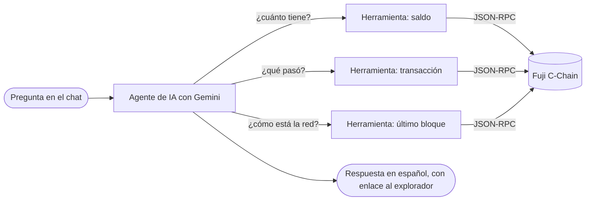

# Agente Web3 que lee Fuji

Un agente de IA que contesta en español preguntas sobre la red Fuji de Avalanche: cuánto tiene una wallet, qué pasó en una transacción, cuál es el último bloque, el saldo de un token o los eventos de un contrato.

| De un vistazo | |
|---|---|
| **Para quién es** | Para equipos que quieren juntar IA y Web3, y para quien quiere entender cómo un agente decide qué herramienta usar. No hace falta saber de blockchain: el agente traduce. |
| **Qué vas a lograr** | Un chat que responde con datos en vivo de Fuji, un agente con herramientas propias y la base para sumarle las que quieras. |
| **Tiempo estimado** | 1 a 2 horas para el agente; 1 hora más por cada herramienta nueva. |
| **Qué necesitás** | Tu n8n, una clave de Gemini ([guía 07](../00-empezar/07-clave-gemini.md)) y, para probar, una dirección y un hash de Fuji ([guía 06](../00-empezar/06-core-wallet-y-fuji.md)). No hace falta ninguna clave de Avalanche: el RPC público es abierto. |
| **Workflows** | [`40-agente-web3-fuji`](https://github.com/nodo-cero-bo/workflows/tree/main/40-proyectos/40-agente-web3-fuji) · [`15-fuji-token-erc20`](https://github.com/nodo-cero-bo/workflows/tree/main/10-avalanche-fuji/15-fuji-token-erc20) · [`16-fuji-eventos-contrato`](https://github.com/nodo-cero-bo/workflows/tree/main/10-avalanche-fuji/16-fuji-eventos-contrato) |

Este proyecto es parte del track de **Avalanche Fuji**, que tiene mención especial para los equipos que integren Fuji.

## La idea

Un agente de IA es un modelo con **herramientas**: cuando le hacés una pregunta, decide si necesita alguna, la llama, mira el resultado y responde. En este proyecto, cada herramienta es un pedido al RPC público de Fuji.



El agente nada más **lee**: no firma ni manda transacciones, y nunca necesita tu frase de recuperación ni tu clave privada.

## Pasos

### 1. Hacé andar el agente

1. Importá [`40-agente-web3-fuji`](https://github.com/nodo-cero-bo/workflows/tree/main/40-proyectos/40-agente-web3-fuji) y conectá tu credencial **Google Gemini(PaLM) Api**.
2. Tocá **Open chat** y probá:

   ```text
   ¿Cuál es el último bloque de Fuji?
   ¿Cuánto AVAX tiene la dirección 0x...?
   Explicame la transacción 0x... como si nunca hubiera usado una wallet.
   ```

3. Después de cada respuesta, abrí la ejecución y mirá los registros del agente: qué herramienta eligió, con qué datos la llamó y qué le devolvió la red.

### 2. Entendé las herramientas

1. Abrí cada herramienta conectada al agente. Fijate en su **descripción**: es el texto con el que el modelo decide cuándo usarla. Una descripción clara («Devuelve el saldo en AVAX de una dirección de Fuji que empieza con 0x») vale más que un modelo más grande.
2. Mirá el mensaje de sistema del agente: le dice que use las herramientas en vez de adivinar y que muestre el enlace al explorador.
3. Probá cambiar una descripción por algo vago y hacé la misma pregunta: vas a ver cómo el agente se confunde. Volvé a dejarla como estaba.

### 3. Sumale una herramienta: saldo de un token ERC-20

1. Importá [`15-fuji-token-erc20`](https://github.com/nodo-cero-bo/workflows/tree/main/10-avalanche-fuji/15-fuji-token-erc20) y ejecutalo tal cual: lee el saldo, el símbolo y los decimales de un token con `eth_call`.
2. Para que el agente lo pueda usar, convertilo en una herramienta:
   - En una copia del workflow 15, cambiá el disparador por **When Executed by Another Workflow** y declará los datos que recibe (por ejemplo, `direccion` y `token`).
   - En el workflow 40, agregá al agente una herramienta **Call n8n Sub-Workflow Tool** que apunte a esa copia.
   - Escribile una descripción clara: qué hace, qué datos necesita y en qué formato.
3. Probá: «¿Cuántos tokens tiene 0x... del token 0x...?».

### 4. Otra herramienta: eventos de un contrato

Con [`16-fuji-eventos-contrato`](https://github.com/nodo-cero-bo/workflows/tree/main/10-avalanche-fuji/16-fuji-eventos-contrato) el agente puede contar qué pasó en un contrato (por ejemplo, las últimas transferencias de un token). Seguí el mismo camino del paso 3. Si desplegaste tu propio contrato con la [guía 06 de proyecto](06-tu-contrato-en-fuji.md), el agente puede contar lo que pasa en él.

### 5. Dale personalidad y publicalo

1. Ajustá el mensaje de sistema para tu público. Por ejemplo, para quienes recién empiezan:

   ```text
   Sos una guía amable de Avalanche Fuji para personas que nunca usaron una wallet.
   Usá siempre tus herramientas para los datos. No inventes saldos ni hashes.
   Explicá con palabras simples y terminá con el enlace al explorador.
   Recordá que Fuji es una red de prueba y sus AVAX no tienen valor.
   ```

2. En el **Chat Trigger**, activá **Make Chat Publicly Available**, publicá con **Publish** y compartí el enlace.

<details>
<summary>Hacelo tuyo: ideas para sumar</summary>

- **Verificar pagos desde el chat**: sumá como herramienta el verificador de [`13-fuji-verificar-pago`](https://github.com/nodo-cero-bo/workflows/tree/main/10-avalanche-fuji/13-fuji-verificar-pago): «¿Llegó mi pago de 0.5 AVAX a la tienda?».
- **Memoria**: cambiá la memoria simple por **Postgres Chat Memory** en Supabase para que recuerde entre sesiones, como en el [asistente de la guía 01](01-asistente-ia-para-tu-comunidad.md).
- **Tutor de Web3**: cargá materiales de Avalanche Academy que hayas resumido vos y combiná la búsqueda en documentos con las herramientas de la red.
- **Avisos**: un workflow con horario que le pida al agente un resumen diario de una wallet.

</details>

## Cómo presentarlo en la demo

1. **El problema**: «Para alguien que recién empieza, un explorador de bloques es una pantalla llena de números en hexadecimal».
2. **La solución**: un agente que lee la red en vivo y la explica en español.
3. **Demo en vivo**:
   - Preguntá por el saldo de una wallet del equipo y mostrá que coincide con Core.
   - Pedí que explique una transacción real y abrí el enlace al explorador que devuelve.
   - Mostrá en n8n los registros del agente: qué herramienta eligió y qué respondió la red.
   - Si sumaste una herramienta propia (token o eventos), mostrala funcionando.
4. **Qué sigue**: qué herramientas sumarías y para quién sería útil.

Llevá anotadas una dirección y un hash que sepas que funcionan, para no tipear en vivo.

## Si algo falla

| Lo que ves | Qué probar |
|---|---|
| El agente responde sin usar herramientas, con datos inventados | Reforzá en el mensaje de sistema que use siempre las herramientas, y revisá que la descripción de cada una diga claramente para qué sirve. |
| La herramienta recibe la dirección mal escrita | En la descripción, pedí el formato exacto: «una dirección que empieza con 0x y tiene 42 caracteres». |
| Los números salen gigantes | Son wei o unidades mínimas del token. La herramienta tiene que dividir por 10^18 (AVAX) o por 10^decimales (token) antes de responder. |
| **Call n8n Sub-Workflow Tool** no encuentra el workflow | El sub-workflow tiene que empezar con **When Executed by Another Workflow** y estar guardado en tu misma instancia. |
| Error `429` de Gemini | Llegaste al límite gratuito por minuto. Esperá y probá con menos preguntas seguidas. |
| El RPC devuelve un error | El RPC público tiene límites. Esperá un momento; si pedís eventos, pedí rangos de bloques más chicos. |

## Para seguir

- Documentación de n8n: [AI Agent](https://docs.n8n.io/integrations/builtin/cluster-nodes/root-nodes/n8n-nodes-langchain.agent/), [Call n8n Workflow Tool](https://docs.n8n.io/integrations/builtin/cluster-nodes/sub-nodes/n8n-nodes-langchain.toolworkflow/), [When Executed by Another Workflow](https://docs.n8n.io/integrations/builtin/core-nodes/n8n-nodes-base.executeworkflowtrigger/) y [HTTP Request](https://docs.n8n.io/integrations/builtin/core-nodes/n8n-nodes-base.httprequest/).
- La [API JSON-RPC de la C-Chain](https://build.avax.network/docs/rpcs/c-chain?utm_source=nodo-cero&utm_medium=github&utm_campaign=hackathon-n8n-bolivia-2026) y el estándar [ERC-20](https://ethereum.org/es/developers/docs/standards/tokens/erc-20/), en español.
- Todo lo de Avalanche junto: [Recursos de Avalanche](../avalanche/recursos.md).

---

[Guías de proyecto](README.md) · Anterior: [Pagos verificables en Fuji](03-pagos-verificables-en-fuji.md) · Siguiente: [Formularios inteligentes](05-formularios-inteligentes.md)
