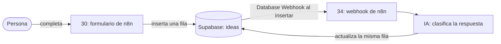

# Formularios inteligentes que guardan y clasifican

Un formulario de n8n que guarda cada respuesta en Supabase y, en cuanto entra, la IA la lee, la clasifica y completa la fila: un buzón de ideas, de consultas o de reclamos que se ordena por su cuenta.

| De un vistazo | |
|---|---|
| **Para quién es** | Para quien nunca usó n8n y quiere un resultado vistoso en poco tiempo, y para quien quiere aprender cómo una base de datos puede disparar un workflow. |
| **Qué vas a lograr** | Un formulario público con su enlace, una tabla en Supabase que se llena sola y una IA que clasifica cada respuesta segundos después de que llega. |
| **Tiempo estimado** | 1 a 2 horas |
| **Qué necesitás** | Tu n8n, un proyecto de Supabase con las tablas de Nodo Cero ([guía 04](../00-empezar/04-cuenta-supabase.md)) y una clave de Gemini ([guía 07](../00-empezar/07-clave-gemini.md)). |
| **Workflows** | [`04-formulario`](https://github.com/nodo-cero-bo/workflows/tree/main/00-fundamentos/04-formulario) (para entrar en calor) · [`30-formulario-a-supabase`](https://github.com/nodo-cero-bo/workflows/tree/main/30-supabase/30-formulario-a-supabase) · [`34-supabase-webhook-ia`](https://github.com/nodo-cero-bo/workflows/tree/main/30-supabase/34-supabase-webhook-ia) |

Palabras de esta guía, explicadas con un ejemplo en el [glosario](../glosario.md): [webhook](../glosario.md#webhook), [base de datos](../glosario.md#base-de-datos), [clasificar](../glosario.md#clasificar) y [RLS](../glosario.md#rls).

## La idea

Dos workflows chicos, cada uno con una tarea, conectados por la base de datos:

Separarlos tiene una ventaja: la fila se puede insertar desde el formulario, desde una app o a mano en Supabase, y la clasificación pasa igual.

## Pasos

### 1. Entrá en calor con un formulario (opcional)

1. Importá [`04-formulario`](https://github.com/nodo-cero-bo/workflows/tree/main/00-fundamentos/04-formulario). No pide credenciales.
2. Tocá **Execute workflow** (ejecutar el workflow): se abre el formulario de prueba. Completalo y mirá la página final.
3. Abrí el nodo del formulario y agregá un campo. Volvé a probar.

### 2. Prepará la tabla

1. Corré `00_esquema.sql` de [`supabase/sql`](https://github.com/nodo-cero-bo/workflows/tree/main/supabase/sql) en el **SQL Editor** ([guía 04, paso 4](../00-empezar/04-cuenta-supabase.md#4-cargá-las-tablas-de-nodo-cero-con-el-sql-editor)).
2. En **Table Editor**, abrí la tabla `ideas` y mirá sus columnas: algunas las llena el formulario y otras las completa la IA.

### 3. El formulario que guarda (workflow 30)

1. Importá [`30-formulario-a-supabase`](https://github.com/nodo-cero-bo/workflows/tree/main/30-supabase/30-formulario-a-supabase) y conectá **Supabase API**.
2. Tocá **Execute workflow**, completá el formulario y mirá la fila nueva en Supabase.
3. Publicalo con **Publish**. Abrí el nodo del formulario y copiá la **Production URL**: ese es el enlace que vas a compartir.

### 4. La IA que clasifica (workflow 34)

1. Importá [`34-supabase-webhook-ia`](https://github.com/nodo-cero-bo/workflows/tree/main/30-supabase/34-supabase-webhook-ia) y conectá sus tres credenciales: **Header Auth** en **Evento de Supabase** (**Name** `x-webhook-secreto` y un secreto largo en **Value**), **Google Gemini(PaLM) Api** y **Supabase API**.
2. Leé la nota del paso de IA. Las categorías están en dos lugares: en la descripción del atributo `categoria` de **Clasificar con IA** (es la instrucción para la IA) y en la lista `VALIDAS` de **Elegir la categoría** (lo que puede llegar a la base). Cambiá las dos por las de tu proyecto (por ejemplo: educacion, ambiente, salud, emprendimiento, otra), en minúsculas y sin tildes.
3. Publicalo y copiá la **Production URL** de **Evento de Supabase** (termina en `/webhook/supabase-ideas`).
4. En Supabase, creá el Database Webhook: **Integrations**, **Database Webhooks**, uno nuevo sobre la tabla `ideas`, evento **Insert**, método `POST`, la URL de n8n, **Timeout** de 5000 ms y, en **HTTP Headers**, `x-webhook-secreto` con el mismo secreto ([guía 04, paso 6](../00-empezar/04-cuenta-supabase.md#6-opcional-avisos-de-la-base-a-n8n)).

> [!WARNING]
> Elegí nada más el evento **Insert**. El workflow 34 actualiza la misma fila: si el webhook también escuchara **Update**, cada actualización dispararía otra, en un bucle sin fin.

### 5. Probá el circuito completo

1. Abrí el enlace de producción del formulario en tu celular y mandá una respuesta.
2. En n8n, mirá **Executions**: primero corre el workflow 30 y, segundos después, el 34.
3. En Supabase, recargá la tabla `ideas`: tu respuesta ya tiene su clasificación.
4. Mandá tres o cuatro respuestas bien distintas y revisá si la IA las clasifica como esperabas. Si no, ajustá las instrucciones del paso de IA.

Hacelo tuyo: ideas para sumar

- **Respuestas estructuradas**: si el paso de IA devuelve texto libre, usá **Structured Output Parser** o el nodo **Information Extractor** para que siempre devuelva los mismos campos.
- **Clasificación sin agente**: el nodo **Text Classifier** de n8n está hecho justo para esto: le das las categorías y elige una.
- **Aviso de lo urgente**: si la IA marca algo como urgente, que n8n avise al equipo.
- **Resumen diario**: un workflow con **Schedule Trigger** que lea las filas del día y arme un resumen con IA.
- **Un asistente que conoce las respuestas**: combinalo con el [asistente de la guía 01](01-asistente-ia-para-tu-comunidad.md).

## Cómo presentarlo en la demo

1. **El problema**: «Recibimos decenas de respuestas y alguien tiene que leerlas y ordenarlas a mano».
2. **La solución**: un formulario que guarda y una IA que clasifica cada respuesta apenas llega.
3. **Demo en vivo**:
   - Mostrá un código QR con el enlace del formulario y pedí al público que lo complete.
   - Con la tabla de Supabase proyectada, recargá y mostrá cómo entran las respuestas y se clasifican.
   - Pasá a n8n y mostrá los dos workflows y cómo se conectan a través de la base.
4. **Qué sigue**: quién lo usaría (una organización, una materia, un emprendimiento) y qué haría con las respuestas ordenadas.

Antes de la demo, cargá algunas respuestas de ejemplo para que la tabla no arranque vacía.

## Si algo falla

| Lo que ves | Qué probar |
|---|---|
| La fila se guarda pero nunca se clasifica | Revisá que el workflow 34 esté publicado, que el Database Webhook use la **Production URL** (`/webhook/`), que esté sobre la tabla y el evento correctos y que mande el encabezado `x-webhook-secreto` con el mismo secreto de la credencial (sin él, n8n responde 403). |
| El workflow 34 corre muchas veces seguidas | El Database Webhook escucha también **Update**. Dejalo nada más en **Insert**. |
| El formulario de producción no abre | El workflow 30 tiene que estar publicado. La URL de prueba funciona mientras n8n está escuchando. |
| La IA devuelve categorías que no existen | Escribí la lista exacta en las instrucciones y pedí que responda con una palabra de esa lista. Mejor todavía: usá **Text Classifier**. |
| Error de Supabase al actualizar | La credencial tiene que usar la clave secreta; la publicable no tiene permiso para escribir con RLS activado. |

## Para seguir

- Documentación de n8n: [n8n Form Trigger](https://docs.n8n.io/integrations/builtin/core-nodes/n8n-nodes-base.formtrigger/), [Form](https://docs.n8n.io/integrations/builtin/core-nodes/n8n-nodes-base.form/), [Supabase](https://docs.n8n.io/integrations/builtin/app-nodes/n8n-nodes-base.supabase/), [Text Classifier](https://docs.n8n.io/integrations/builtin/cluster-nodes/root-nodes/n8n-nodes-langchain.text-classifier/) e [Information Extractor](https://docs.n8n.io/integrations/builtin/cluster-nodes/root-nodes/n8n-nodes-langchain.information-extractor/).
- Documentación de Supabase: [Database Webhooks](https://supabase.com/docs/guides/database/webhooks) y [tablas](https://supabase.com/docs/guides/database/tables).
- Una versión con causa: [Impacto ambiental o social](07-impacto-ambiental-o-social.md).

---

[Guías de proyecto](README.md) · Anterior: [Agente Web3 que lee Fuji](04-agente-web3-que-lee-fuji.md) · Siguiente: [Tu contrato en Fuji](06-tu-contrato-en-fuji.md)
