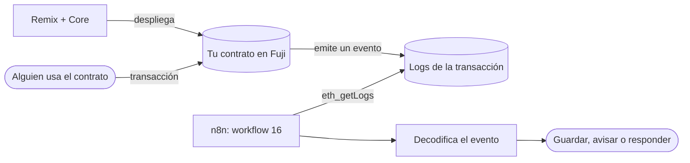

# Tu contrato en Fuji y n8n escuchando sus eventos

Desplegá tu propio contrato inteligente en la red Fuji con Remix y Core Wallet, y armá un workflow de n8n que lee los eventos que emite: cada vez que alguien lo usa, n8n se entera y actúa.

| De un vistazo | |
|---|---|
| **Para quién es** | Para quien quiere ir un paso más allá de leer la red y dejar algo propio en ella. Ayuda haber programado algo antes, pero el contrato de ejemplo ya está escrito y comentado. |
| **Qué vas a lograr** | Un contrato tuyo en Fuji con su dirección, transacciones que emiten eventos y un workflow que los lee, los decodifica y los guarda o los avisa. |
| **Tiempo estimado** | 2 a 3 horas |
| **Qué necesitás** | Core Wallet en Fuji con AVAX de prueba ([guía 06](../00-empezar/06-core-wallet-y-fuji.md)), Chrome o un navegador basado en Chromium con la extensión de Core, tu n8n y la carpeta [`avalanche/contratos`](https://github.com/nodo-cero-bo/workflows/tree/main/avalanche/contratos) del repo de workflows. |
| **Workflows** | [`16-fuji-eventos-contrato`](https://github.com/nodo-cero-bo/workflows/tree/main/10-avalanche-fuji/16-fuji-eventos-contrato) · [`avalanche/contratos`](https://github.com/nodo-cero-bo/workflows/tree/main/avalanche/contratos) · para escuchar seguido, el patrón de [`14-fuji-monitor-wallet`](https://github.com/nodo-cero-bo/workflows/tree/main/10-avalanche-fuji/14-fuji-monitor-wallet) |

Este proyecto es parte del track de **Avalanche Fuji**, que tiene mención especial para los equipos que integren Fuji.

## La idea

Un contrato inteligente es un programa que vive en la blockchain. Cuando algo importante pasa adentro (alguien se registra, paga o vota), el contrato puede **emitir un evento**: un registro público que queda guardado en la transacción. n8n no necesita ninguna clave para leerlos: le pide al RPC público los eventos de tu contrato con `eth_getLogs`.



### Cómo encuentra n8n tus eventos: el topic0

Cada evento se identifica por un número, el **topic0**: el hash keccak256 de su firma. El contrato de ejemplo, `RegistroNodoCero`, emite este:

```solidity
event ProyectoRegistrado(address indexed autora, string nombre, string enlace, uint256 cuando);
```

La firma es el nombre y los tipos completos, sin espacios, sin `indexed` y sin los nombres de los parámetros:

```text
ProyectoRegistrado(address,string,string,uint256)
```

Y su topic0, ya calculado, es:

```text
0xa349a1d38906b94dcd1cbd81cc94738a389a4deaf16ae3d301bc1617cc04df77
```

Los parámetros `indexed` viajan en los topics siguientes: acá, `autora` (quien firmó la transacción) va en `topics[1]`. El resto (`nombre`, `enlace` y `cuando`, la hora del bloque) viaja junto en `data`, codificado con la ABI. El README de [`avalanche/contratos`](https://github.com/nodo-cero-bo/workflows/tree/main/avalanche/contratos) explica cómo se calculó y cómo calcular el de tu evento si lo cambiás.

## Pasos

### 1. Leé el contrato de ejemplo

1. Abrí [`avalanche/contratos`](https://github.com/nodo-cero-bo/workflows/tree/main/avalanche/contratos) y leé su README de punta a punta: tiene la guía detallada para desplegar.
2. Abrí [`RegistroNodoCero.sol`](https://github.com/nodo-cero-bo/workflows/blob/main/avalanche/contratos/RegistroNodoCero.sol) y leé los comentarios. Es un registro público de proyectos:
   - **`registrar(nombre, enlace)`** es una transacción: la firmás con Core y cuesta un poco de gas (AVAX de prueba). El nombre no puede ir vacío y los textos tienen un largo máximo (100 y 200 bytes).
   - Cada registro emite **`ProyectoRegistrado`**. Los textos no se guardan en el contrato, nada más en el evento: es más barato y es justo lo que lee n8n.
   - **`totalProyectos()`** es una lectura gratis: cuántos proyectos se registraron.

### 2. Compilalo en Remix

1. Abrí [Remix](https://remix.ethereum.org), el editor de contratos en el navegador.
2. En **File explorer**, creá un archivo `RegistroNodoCero.sol` y pegá el código.
3. Abrí el panel **Solidity Compiler**. En **Compiler**, elegí una versión 0.8 desde la 0.8.20 (por ejemplo, 0.8.30).
4. En **Advanced Configurations**, poné **EVM Version** en `cancun`. La [documentación de Avalanche](https://build.avax.network/docs/avalanche-l1s/add-utility/deploy-smart-contract?utm_source=nodo-cero&utm_medium=github&utm_campaign=hackathon-n8n-bolivia-2026) lo pide porque la C-Chain todavía no admite las versiones más nuevas de la EVM, que son las que eligen por defecto los compiladores recientes (desde Solidity 0.8.30).
5. Tocá **Compile RegistroNodoCero.sol**. Si aparece un tilde verde, está listo.

### 3. Desplegalo en Fuji con Core

1. En Core, confirmá que estás en **Testnet Mode** y que tenés AVAX de prueba.
2. En Remix, abrí el panel **Deploy & Run Transactions**.
3. En **Environment**, elegí la opción que empieza con **Injected Provider** (puede aparecer con el nombre de Core). Core te pide permiso para conectarse: aceptá.
4. Revisá que la red que muestra Remix sea la de chain ID `43113` (Fuji) y que en **Account** esté tu dirección.
5. En **Contract** tiene que estar `RegistroNodoCero`. Tocá **Deploy** y confirmá la transacción en Core.
6. En **Deployed Contracts** aparece tu contrato: copiá su dirección (empieza con `0x`). Guardala junto con el número de bloque del despliegue, que ves en el explorador.

### 4. Usalo y mirá el evento en el explorador

1. En **Deployed Contracts**, desplegá tu contrato.
2. En `registrar`, completá `nombre` (por ejemplo, `Las Fujinas`) y `enlace` (el de tu repo, o `""` si todavía no tenés), tocá **transact** y confirmá en Core.
3. Tocá `totalProyectos`: ahora dice `1`. Esa lectura no pide confirmación ni gasta gas.
4. Copiá el hash de la transacción (desde la consola de Remix o desde Core) y abrilo en el explorador de Fuji:

   ```text
   https://build.avax.network/explorer/fuji/c-chain/tx/<hash>
   ```

5. En el detalle de la transacción buscá los logs: ahí está `ProyectoRegistrado`, con el topic0 `0xa349a1d3...` y tus datos.

### 5. Leé los eventos con n8n (workflow 16)

1. Importá [`16-fuji-eventos-contrato`](https://github.com/nodo-cero-bo/workflows/tree/main/10-avalanche-fuji/16-fuji-eventos-contrato). No pide credenciales.
2. Tocá **Execute** (ejecutar el workflow) tal cual viene y abrí **Decodificar los eventos**: el ejemplo trae las transferencias del USDC de prueba de los últimos 300 bloques, ya decodificadas.
3. En el nodo **Qué buscar**, poné los datos de tu contrato:

   | Campo | Valor |
   |---|---|
   | `contrato` | la dirección de tu contrato |
   | `topic0` | `0xa349a1d38906b94dcd1cbd81cc94738a389a4deaf16ae3d301bc1617cc04df77` |
   | `desdeBloque` | el bloque del despliegue |
   | `decimales` | vacío |

4. Tocá **Execute** otra vez: sale un ítem por proyecto registrado, con `autora`, `nombre`, `enlace` y `cuando` legibles. Por ejemplo:

   ```json
   { "evento": "ProyectoRegistrado", "autora": "0x00000000000000000000000000000000000c0de0", "nombre": "Las Fujinas", "enlace": "https://github.com/nodo-cero-bo/proyectos", "cuando": "21/11/2026 03:00:00" }
   ```

5. Volvé a usar el contrato desde Remix y ejecutá otra vez el workflow: aparece el evento nuevo.

El RPC público de Fuji acepta hasta 100 bloques por pedido de eventos: el workflow parte el rango en tramos de 100 y mira hasta 1000 bloques desde `desdeBloque`. Si tu contrato es más viejo, mové `desdeBloque` hacia adelante de a 1000.

### 6. Que n8n escuche por su cuenta

Para que n8n reaccione sin que toques nada, usá el mismo patrón que [`14-fuji-monitor-wallet`](https://github.com/nodo-cero-bo/workflows/tree/main/10-avalanche-fuji/14-fuji-monitor-wallet):

1. Cambiá el disparador del workflow 16 por un **Schedule Trigger** (por ejemplo, cada cinco minutos).
2. Guardá el último bloque revisado en los datos estáticos del workflow, como hace el 14, y en cada vuelta pedí los eventos desde ese bloque en adelante.
3. Por cada evento nuevo, hacé algo: guardalo en Supabase, mandá un aviso o pasáselo a un agente.
4. Publicá el workflow con **Publish**. Los datos estáticos se guardan cuando corre publicado, no en las pruebas manuales.

<details>
<summary>Hacelo tuyo: ideas de contratos</summary>

- **Registro de proyectos o asistencia**: es lo que ya hace `RegistroNodoCero`. Cada persona registra desde su Core (para una asistencia, `registrar` con el nombre del taller) y n8n arma la lista pública.
- **Otro evento**: cambiá el nombre o los parámetros del evento, recalculá el topic0 con la firma nueva y sumalo en **Decodificar los eventos** del workflow 16.
- **Votación simple**: un evento por voto; n8n cuenta y publica el resultado.
- **Certificados de participación**: el contrato registra quién completó un taller y n8n genera la página de cada certificado.
- **Reportes verificables**: los reportes ciudadanos de la [guía 07](07-impacto-ambiental-o-social.md), registrados en Fuji para que nadie los pueda borrar.

Para aprender Solidity desde cero, el curso [Intro to Solidity](https://build.avax.network/academy/blockchain/solidity-foundry?utm_source=nodo-cero&utm_medium=github&utm_campaign=hackathon-n8n-bolivia-2026) de Avalanche Academy cubre funciones, eventos y tokens.

</details>

## Cómo presentarlo en la demo

1. **El problema**: qué necesita quedar registrado de forma pública y sin que nadie lo pueda cambiar.
2. **La solución**: tu contrato en Fuji y n8n reaccionando a lo que pasa en él.
3. **Demo en vivo**:
   - Mostrá el contrato ya desplegado en el explorador de Fuji (desplegalo antes, no en vivo).
   - Registrá un proyecto en vivo desde Remix o desde tu página y confirmá en Core.
   - Ejecutá el workflow (o esperá al horario) y mostrá el evento nuevo decodificado.
   - Mostrá qué hace n8n con ese evento: la fila en Supabase, el aviso o la respuesta.
4. **Qué sigue**: qué más registraría el contrato y quién lo usaría.

Tené preparado un hash con el evento ya emitido, por si la red tarda durante la demo.

## Si algo falla

| Lo que ves | Qué probar |
|---|---|
| Remix no muestra **Injected Provider** o no conecta | Revisá que la extensión de Core esté activa y desbloqueada, y que no haya otra wallet respondiendo primero. Recargá Remix. |
| Remix muestra otra red | Activá **Testnet Mode** en Core y volvé a conectar. |
| El despliegue falla sin un motivo claro | Revisá que **EVM Version** esté en `cancun` antes de compilar. Compilá de nuevo y volvé a desplegar. |
| La transacción falla por saldo | Pedí más AVAX de prueba en el [faucet](https://build.avax.network/console/primary-network/faucet?utm_source=nodo-cero&utm_medium=github&utm_campaign=hackathon-n8n-bolivia-2026). |
| `registrar` falla con «Falta el nombre» o «muy largo» | Son las reglas del contrato: el nombre no puede ir vacío, llega hasta 100 bytes y el enlace hasta 200 (una letra con tilde ocupa 2 bytes). |
| El workflow no encuentra eventos | Revisá la dirección del contrato, el topic0 (si cambiaste el evento: firma sin espacios y con tipos completos, `uint256` y no `uint`) y que `desdeBloque` sea anterior a tus transacciones y esté a menos de 1000 bloques de ellas. |
| El RPC responde «block range too large» o 429 | El RPC público acepta hasta 100 bloques por pedido y limita los pedidos por minuto. El workflow 16 ya parte el rango en tramos de 100: no los agrandes, y si ves 429, esperá un minuto. |
| El evento sale como `"otro"`, con `topics` y `data` crudos | El workflow 16 decodifica `Transfer` y `ProyectoRegistrado`. Si cambiaste el evento, sumá su topic0 en **Decodificar los eventos** y decodificá `data` según sus tipos, como hace con `ProyectoRegistrado`. |

## Para seguir

- [Recursos de Avalanche](../avalanche/recursos.md): Academy, Team1 y la documentación.
- Cómo [verificar tu contrato en el explorador](https://build.avax.network/docs/primary-network/verify-contract/explorer?utm_source=nodo-cero&utm_medium=github&utm_campaign=hackathon-n8n-bolivia-2026), para que cualquiera pueda leer su código.
- La [documentación de Solidity sobre eventos](https://docs.soliditylang.org/en/latest/contracts.html#events) y [qué es un contrato inteligente](https://ethereum.org/es/developers/docs/smart-contracts/), en español.
- La [API JSON-RPC de la C-Chain](https://build.avax.network/docs/rpcs/c-chain?utm_source=nodo-cero&utm_medium=github&utm_campaign=hackathon-n8n-bolivia-2026), con `eth_getLogs`.
- Que un agente cuente lo que pasa en tu contrato: [Agente Web3](04-agente-web3-que-lee-fuji.md).

---

[Guías de proyecto](README.md) · Anterior: [Formularios inteligentes](05-formularios-inteligentes.md) · Siguiente: [Impacto ambiental o social](07-impacto-ambiental-o-social.md)
