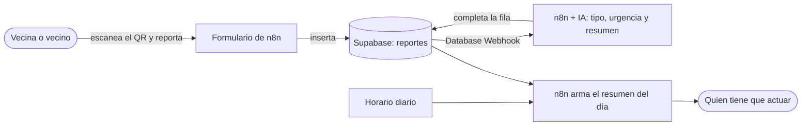

# Impacto ambiental o social: reportes ciudadanos

Una idea abierta, inspirada en la sede, el Centro de Educación Ambiental: reportes ciudadanos de basurales, quemas o fugas de agua que la IA ordena y que quedan guardados para darles seguimiento.

| De un vistazo | |
|---|---|
| **Para quién es** | Para equipos con una causa: ambiente, barrio, escuela, salud comunitaria, accesibilidad. El ejemplo es ambiental, pero el mismo esqueleto sirve para cualquier tema social. |
| **Qué vas a lograr** | Un formulario público para reportar, una tabla en Supabase con cada reporte, una IA que lo clasifica por tipo y urgencia, y un resumen para quien tiene que actuar. |
| **Tiempo estimado** | 2 a 3 horas |
| **Qué necesitás** | Tu n8n, un proyecto de Supabase ([guía 04](../00-empezar/04-cuenta-supabase.md)) y una clave de Gemini ([guía 07](../00-empezar/07-clave-gemini.md)). Ayuda haber hecho antes [Formularios inteligentes](05-formularios-inteligentes.md), porque este proyecto parte de ahí. |
| **Workflows** | [`04-formulario`](https://github.com/nodo-cero-bo/workflows/tree/main/00-fundamentos/04-formulario) · [`30-formulario-a-supabase`](https://github.com/nodo-cero-bo/workflows/tree/main/30-supabase/30-formulario-a-supabase) · [`34-supabase-webhook-ia`](https://github.com/nodo-cero-bo/workflows/tree/main/30-supabase/34-supabase-webhook-ia) · opcional: [`33-agente-con-memoria-y-rag`](https://github.com/nodo-cero-bo/workflows/tree/main/30-supabase/33-agente-con-memoria-y-rag) y [`16-fuji-eventos-contrato`](https://github.com/nodo-cero-bo/workflows/tree/main/10-avalanche-fuji/16-fuji-eventos-contrato) |

## La idea

Mucha gente ve un problema en su barrio y no sabe a quién avisar, o avisa por un chat donde el mensaje se pierde. Un buen sistema de reportes hace tres cosas: recibe fácil, ordena por su cuenta y no pierde nada.



Antes de construir, definan en equipo: **¿quién recibe los reportes y qué hace con ellos?** Una organización, una junta vecinal, un centro de estudiantes. Sin esa respuesta, el sistema junta datos que nadie mira.

## Pasos

### 1. Creá la tabla de reportes

En Supabase, abrí el **SQL Editor**, pegá esto y tocá **Run**:

```sql
-- Reportes ciudadanos: una fila por reporte.
create table public.reportes (
  id bigint generated always as identity primary key,
  creado_en timestamptz not null default now(),
  categoria_elegida text not null,  -- la que elige la persona en el formulario
  zona text not null,               -- barrio o una referencia, nunca la dirección de una casa
  descripcion text not null,
  categoria_ia text,                -- la completa la IA
  urgencia text,                    -- alta, media o baja: la completa la IA
  resumen_ia text,                  -- una frase: la completa la IA
  estado text not null default 'nuevo'
);

-- RLS activado y sin políticas: con la clave publicable nadie puede leer ni escribir.
-- n8n usa la clave secreta, que saltea RLS, así que los workflows siguen funcionando.
alter table public.reportes enable row level security;
```

En **Table Editor** tiene que aparecer `reportes`, vacía.

### 2. Armá el formulario

1. Importá [`30-formulario-a-supabase`](https://github.com/nodo-cero-bo/workflows/tree/main/30-supabase/30-formulario-a-supabase) y conectá **Supabase API**. Si nunca armaste un formulario, mirá antes [`04-formulario`](https://github.com/nodo-cero-bo/workflows/tree/main/00-fundamentos/04-formulario).
2. Cambiale el nombre (por ejemplo, `Reportes · formulario`) y, en el nodo del formulario, dejá estos campos:

   | Campo | Tipo | Detalle |
   |---|---|---|
   | ¿Qué querés reportar? | Lista desplegable | Basural, Quema, Agua, Árboles, Otro |
   | Zona | Texto | «Barrio o una referencia cercana. No pongas la dirección de una casa.» |
   | Contanos qué pasa | Texto largo | Obligatorio |

3. En el nodo de Supabase, cambiá la tabla por `reportes` y mapeá cada campo del formulario a su columna (`categoria_elegida`, `zona`, `descripcion`).
4. En la página final del formulario, agradecé y contá qué pasa con el reporte.
5. Probalo con **Execute** (ejecutar el workflow) y mirá la fila en Supabase.

> [!IMPORTANT]
> No pidas nombre, teléfono ni correo. Un reporte anónimo protege a quien avisa y te evita guardar datos personales. Si alguna vez necesitás un contacto, que sea opcional, explicá para qué lo usás y nunca lo publiques.

### 3. Que la IA ordene cada reporte

1. Importá [`34-supabase-webhook-ia`](https://github.com/nodo-cero-bo/workflows/tree/main/30-supabase/34-supabase-webhook-ia) y conectá sus tres credenciales: **Header Auth** en **Evento de Supabase** (**Name** `x-webhook-secreto` y un secreto largo en **Value**), **Google Gemini(PaLM) Api** y **Supabase API**.
2. El workflow viene preparado para la tabla `ideas`. En **Leer el evento**, cambiá `'ideas'` por `'reportes'` y `fila.idea` por `fila.descripcion`: así acepta los reportes y le pasa a la IA su descripción.
3. En **Clasificar con IA** (un Information Extractor), cambiá los atributos por `categoria`, `urgencia` y `resumen`. La descripción de cada atributo es la instrucción para la IA: usá este texto como guía.

   ```text
   Vas a recibir un reporte ciudadano de Santa Cruz de la Sierra.
   Devolvé tres campos:
   - categoria: una de basural, quema, agua, arboles, otro.
   - urgencia: alta si hay riesgo para personas o fuego activo; media si empeora con los días; baja en otro caso.
   - resumen: una frase de hasta 20 palabras, sin datos personales.
   ```

4. En **Elegir la categoría**, cambiá la lista `VALIDAS` por `basural`, `quema`, `agua`, `arboles` y `otro`, y sumá `urgencia` y `resumen` a lo que devuelve.
5. En **Guardar la categoría**, el nodo que actualiza la fila, cambiá la tabla por `reportes` y escribí `categoria_ia`, `urgencia` y `resumen_ia`, buscando la fila por su `id`.
6. Publicalo, copiá la **Production URL** de **Evento de Supabase** y creá en Supabase un Database Webhook sobre `reportes`, evento **Insert** nada más, con `x-webhook-secreto` y tu secreto en **HTTP Headers** ([guía 04, paso 6](../00-empezar/04-cuenta-supabase.md#6-opcional-avisos-de-la-base-a-n8n)).
7. Publicá también el formulario, mandá un reporte desde el celular y mirá cómo se completa la fila.

### 4. El resumen del día

1. Creá un workflow nuevo que empiece con un **Schedule Trigger** (por ejemplo, todos los días a las 18:00).
2. Agregá un nodo de Supabase que lea los reportes del día.
3. Agregá un paso de IA que arme un resumen: cuántos hay por tipo, cuáles son urgentes y en qué zonas se repiten.
4. Mandá el resumen a quien tiene que actuar, por el canal que use (un correo, un mensaje o una página).
5. Publicalo.

<details>
<summary>Hacelo tuyo: ideas para sumar</summary>

- **Foto del problema**: el formulario de n8n acepta archivos. Guardá la imagen en Supabase Storage y su enlace en la fila. Avisá que la foto no muestre caras ni patentes.
- **Asistente que responde dudas**: cargá guías públicas (cómo separar residuos, qué hacer ante una quema) y armá un asistente con [`33-agente-con-memoria-y-rag`](https://github.com/nodo-cero-bo/workflows/tree/main/30-supabase/33-agente-con-memoria-y-rag), como en la [guía 01](01-asistente-ia-para-tu-comunidad.md).
- **Estado del reporte**: que la organización cambie `estado` a «en curso» o «resuelto» y n8n lo refleje en una página pública con los números del mes.
- **Reportes verificables en Fuji**: que cada reporte se registre en un contrato propio, para que nadie lo pueda borrar, y que n8n lo lea con [`16-fuji-eventos-contrato`](https://github.com/nodo-cero-bo/workflows/tree/main/10-avalanche-fuji/16-fuji-eventos-contrato). Seguí la [guía 06 de proyecto](06-tu-contrato-en-fuji.md).

</details>

## Cómo presentarlo en la demo

1. **El problema, con una situación concreta**: un basural que crece en una esquina y nadie sabe a quién avisar.
2. **La solución**: reportar en treinta segundos desde el celular, y que el sistema ordene y avise.
3. **Demo en vivo**:
   - Mostrá el QR del formulario y pedí que alguien del público mande un reporte.
   - Con la tabla de Supabase proyectada, mostrá cómo entra el reporte y cómo la IA completa tipo, urgencia y resumen.
   - Mostrá el resumen del día (ejecutá el workflow a mano para no esperar al horario).
   - Si sumaste Fuji, mostrá el reporte registrado en el explorador.
4. **Qué sigue**: quién recibiría los reportes y qué haría falta para que lo usen de verdad.

Cargá antes algunos reportes de ejemplo, inventados y sin datos de nadie, para que el resumen tenga algo que contar.

## Si algo falla

| Lo que ves | Qué probar |
|---|---|
| El formulario guarda, pero la IA nunca completa la fila | El workflow de IA tiene que estar publicado y el Database Webhook, sobre `reportes`, evento **Insert** y con la **Production URL**. |
| El workflow de IA corre en bucle | El Database Webhook escucha también **Update**. Dejalo nada más en **Insert**. |
| La IA devuelve una categoría fuera de la lista | Repetí la lista exacta en las instrucciones y pedí que responda con una de esas palabras. Para algo más firme, usá el nodo **Text Classifier**. |
| Error `null value in column` al insertar | Un campo obligatorio de la tabla no llegó: revisá el mapeo del formulario a las columnas. |
| El resumen diario sale vacío | Revisá el filtro de fecha: Supabase guarda `creado_en` en UTC y Bolivia está cuatro horas atrás. |

## Para seguir

- Documentación de Supabase: [tablas](https://supabase.com/docs/guides/database/tables), [Row Level Security](https://supabase.com/docs/guides/database/postgres/row-level-security) y [Database Webhooks](https://supabase.com/docs/guides/database/webhooks).
- Documentación de n8n: [n8n Form Trigger](https://docs.n8n.io/integrations/builtin/core-nodes/n8n-nodes-base.formtrigger/), [Schedule Trigger](https://docs.n8n.io/integrations/builtin/core-nodes/n8n-nodes-base.scheduletrigger/) y [Text Classifier](https://docs.n8n.io/integrations/builtin/cluster-nodes/root-nodes/n8n-nodes-langchain.text-classifier/).
- Más ideas por área: el [banco de ideas](../ideas.md).

---

[Guías de proyecto](README.md) · Anterior: [Tu contrato en Fuji](06-tu-contrato-en-fuji.md) · Siguiente: [Automatizá tu emprendimiento](08-automatiza-tu-emprendimiento.md)
