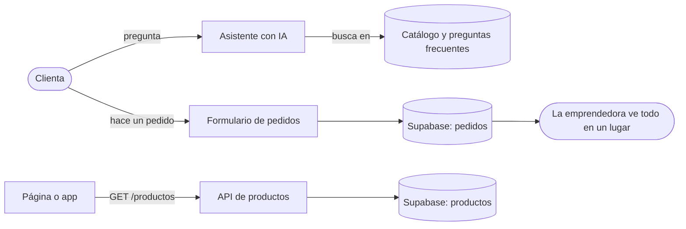

# Automatizá tu emprendimiento

Pedidos, consultas y catálogo de un emprendimiento atendidos por n8n: un formulario que toma pedidos, una API con los productos, un asistente que responde las preguntas de siempre y, si querés, cobros verificados en Fuji.

| De un vistazo | |
|---|---|
| **Para quién es** | Para quien tiene un emprendimiento (o conoce uno de cerca: una pastelería, una tienda de ropa, clases particulares) y pierde horas contestando mensajes y anotando pedidos a mano. |
| **Qué vas a lograr** | Un sistema chico pero completo: catálogo y pedidos en Supabase, un formulario de pedidos, una API que lista productos y un asistente que contesta con la información del negocio. |
| **Tiempo estimado** | 2 a 3 horas para pedidos y catálogo; 1 hora más por cada pieza opcional. |
| **Qué necesitás** | Tu n8n, un proyecto de Supabase ([guía 04](../00-empezar/04-cuenta-supabase.md)) y, para el asistente, una clave de Gemini ([guía 07](../00-empezar/07-clave-gemini.md)). Y el emprendimiento: sus productos, precios y preguntas frecuentes. |
| **Workflows** | [`02-mi-primera-api`](https://github.com/nodo-cero-bo/workflows/tree/main/00-fundamentos/02-mi-primera-api) · [`30-formulario-a-supabase`](https://github.com/nodo-cero-bo/workflows/tree/main/30-supabase/30-formulario-a-supabase) · [`31-api-crud-supabase`](https://github.com/nodo-cero-bo/workflows/tree/main/30-supabase/31-api-crud-supabase) · [`32-cargar-documentos-rag`](https://github.com/nodo-cero-bo/workflows/tree/main/30-supabase/32-cargar-documentos-rag) · [`33-agente-con-memoria-y-rag`](https://github.com/nodo-cero-bo/workflows/tree/main/30-supabase/33-agente-con-memoria-y-rag) · opcional: [`13-fuji-verificar-pago`](https://github.com/nodo-cero-bo/workflows/tree/main/10-avalanche-fuji/13-fuji-verificar-pago) |

Palabras de esta guía, explicadas con un ejemplo en el [glosario](../glosario.md): [API](../glosario.md#api), [base de datos](../glosario.md#base-de-datos), [RAG](../glosario.md#rag), [agente](../glosario.md#agente) y [hash](../glosario.md#hash).

## La idea

No automatices todo de golpe. Elegí **el proceso que más tiempo le come al negocio** y empezá por ahí. Este proyecto propone tres piezas que se suman de a una:



## Pasos

### 1. Elegí el proceso y contalo en una frase

Antes de abrir n8n, escribí en una frase qué pasa hoy y cuánto tiempo lleva. Por ejemplo: «Cada noche paso una hora copiando los pedidos del chat a un cuaderno». Esa frase es el corazón de tu demo.

### 2. Creá las tablas

En Supabase, **SQL Editor**, pegá esto y tocá **Run**:

```sql
-- Catálogo: lo que vende el emprendimiento.
create table public.productos (
  id bigint generated always as identity primary key,
  nombre text not null,
  precio numeric(10, 2) not null check (precio >= 0),
  disponible boolean not null default true,
  descripcion text
);

-- Pedidos: una fila por pedido.
create table public.pedidos (
  id bigint generated always as identity primary key,
  creado_en timestamptz not null default now(),
  producto text not null,
  cantidad integer not null check (cantidad > 0),
  entrega text,                      -- retiro o envío
  nota text,
  estado text not null default 'nuevo'
);

-- RLS activado y sin políticas: nadie entra con la clave publicable.
-- n8n usa la clave secreta, que saltea RLS.
alter table public.productos enable row level security;
alter table public.pedidos enable row level security;
```

Cargá tres o cuatro productos desde **Table Editor**, con **Insert row**.

### 3. El formulario de pedidos

1. Importá [`30-formulario-a-supabase`](https://github.com/nodo-cero-bo/workflows/tree/main/30-supabase/30-formulario-a-supabase), conectá **Supabase API** y cambiale el nombre (por ejemplo, `Pedidos · formulario`).
2. En el formulario, dejá los campos del pedido: producto (lista desplegable con tus productos), cantidad (número), entrega (retiro o envío) y una nota.
3. En el nodo de Supabase, cambiá la tabla por `pedidos` y mapeá cada campo a su columna.
4. En la página final, confirmá el pedido y contá qué pasa después («Te escribimos para coordinar la entrega»).
5. Probalo, publicalo y compartí el enlace de producción (en la bio, en un QR en el local, en el estado del celular).

### 4. La API de productos

1. Si nunca armaste una API, empezá por [`02-mi-primera-api`](https://github.com/nodo-cero-bo/workflows/tree/main/00-fundamentos/02-mi-primera-api): un Webhook que responde JSON.
2. Importá [`31-api-crud-supabase`](https://github.com/nodo-cero-bo/workflows/tree/main/30-supabase/31-api-crud-supabase) y conectá **Supabase API**.
3. Cambiá la tabla por `productos` en sus nodos de Supabase (**Listar ideas** y **Crear la idea**) y adaptá **Validar la idea** a las columnas de `productos`. Si querés, cambiá también el **Path** del Webhook (viene `ideas`) por `productos`.
4. Probá listar: abrí la URL del Webhook en el navegador (o con `curl`) y mirá el JSON con tus productos.
5. Si la API permite crear filas, protegela antes de publicarla (por ejemplo, con una credencial **Header Auth** en el Webhook) para que nadie cargue productos falsos.

Con esa API, una página web o una app pueden mostrar el catálogo siempre al día, sin tocar el código cada vez que cambia un precio.

### 5. El asistente que responde las preguntas de siempre

1. Escribí un documento con la información del negocio: productos, precios, horarios, zonas de envío, formas de pago y las preguntas que más te hacen.
2. Cargalo con [`32-cargar-documentos-rag`](https://github.com/nodo-cero-bo/workflows/tree/main/30-supabase/32-cargar-documentos-rag) y armá el agente con [`33-agente-con-memoria-y-rag`](https://github.com/nodo-cero-bo/workflows/tree/main/30-supabase/33-agente-con-memoria-y-rag), siguiendo la [guía 01](01-asistente-ia-para-tu-comunidad.md).
3. En el mensaje de sistema, decile que termine cada respuesta con el enlace al formulario de pedidos.
4. Publicá el chat y probalo con las preguntas reales que recibe el negocio.

<details>
<summary>Opcional: cobrar con AVAX de prueba y verificarlo en Fuji</summary>

Para mostrar cómo sería un cobro verificable, sumá a la página final del pedido la dirección `0x` del negocio y el monto, y un segundo formulario donde la clienta pega el hash de su pago. n8n lo verifica con [`13-fuji-verificar-pago`](https://github.com/nodo-cero-bo/workflows/tree/main/10-avalanche-fuji/13-fuji-verificar-pago) y cambia el `estado` del pedido a «pagado». Todo en la red de prueba: los AVAX de Fuji no tienen valor. La guía completa está en [Pagos verificables en Fuji](03-pagos-verificables-en-fuji.md).

</details>

<details>
<summary>Hacelo tuyo: más ideas</summary>

- **Aviso de pedido nuevo**: cuando entra un pedido, que n8n le mande un mensaje a la emprendedora.
- **Resumen del día**: un **Schedule Trigger** que cuente los pedidos y lo que hay que preparar para mañana.
- **Clasificar consultas**: con la idea de [Formularios inteligentes](05-formularios-inteligentes.md), que la IA separe pedidos, reclamos y consultas.
- **Stock**: que al confirmar un pedido se descuente del producto y, si llega a cero, `disponible` pase a falso.

</details>

## Cómo presentarlo en la demo

1. **El problema**: la frase del paso 1, con el tiempo que lleva hoy (si lo midieron; si no, no lo inventen).
2. **La solución**: qué hace n8n por el negocio, en dos frases.
3. **Demo en vivo, como si fueras la clienta**:
   - Preguntale al asistente por un producto y un horario.
   - Seguí el enlace al formulario y hacé un pedido.
   - Cambiá de rol: mostrá el pedido en la tabla de Supabase, ya ordenado.
   - Mostrá la API devolviendo el catálogo y, si lo sumaste, el pago verificado en Fuji.
4. **Qué sigue**: qué emprendimiento real lo usaría y qué le falta para usarlo mañana.

Si el negocio es real, pedí permiso antes de mostrar su nombre y sus datos, y usá pedidos de prueba.

## Si algo falla

| Lo que ves | Qué probar |
|---|---|
| El formulario da error al guardar | Revisá que la tabla sea `pedidos` y que cada campo obligatorio (`producto`, `cantidad`) llegue con valor. La cantidad tiene que ser un número mayor que cero. |
| La API devuelve una lista vacía | Revisá que la tabla sea `productos` y que tenga filas. Con la clave secreta, RLS no la bloquea. |
| El asistente inventa precios | Reforzá en el mensaje de sistema que responda con lo que está en el documento y, si no lo encuentra, que mande al formulario o a un contacto del negocio. |
| El asistente no conoce un producto nuevo | El documento quedó viejo: volvé a cargarlo con el workflow 32 (y borrá las filas del anterior en `documentos`). |
| Cualquiera puede crear productos con la API | Protegé el Webhook con una credencial de autenticación antes de publicarlo. |

## Para seguir

- Documentación de n8n: [Webhook](https://docs.n8n.io/integrations/builtin/core-nodes/n8n-nodes-base.webhook/), [Respond to Webhook](https://docs.n8n.io/integrations/builtin/core-nodes/n8n-nodes-base.respondtowebhook/), [Supabase](https://docs.n8n.io/integrations/builtin/app-nodes/n8n-nodes-base.supabase/) y [n8n Form Trigger](https://docs.n8n.io/integrations/builtin/core-nodes/n8n-nodes-base.formtrigger/).
- Plantillas de la comunidad para negocios: [n8n.io/workflows](https://n8n.io/workflows/).
- Cuando el sistema funcione, documentalo y registralo: [Seguir construyendo](../seguir-construyendo.md).

---

[Guías de proyecto](README.md) · Anterior: [Impacto ambiental o social](07-impacto-ambiental-o-social.md) · Siguiente: [Traducí y resumí con Google Cloud](09-traducir-y-resumir-con-google-cloud.md)
