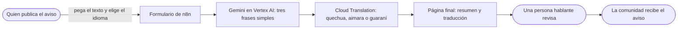

# Traducí y resumí con Google Cloud

Un aviso largo en español se vuelve tres frases simples y llega en quechua, en aimara o en guaraní: Gemini en Vertex AI lo resume y Cloud Translation lo traduce. Para que la información de tu comunidad llegue a más gente.

| De un vistazo | |
|---|---|
| **Para quién es** | Para equipos de la línea [IA para tu comunidad](../lineas/ia.md) o de [Impacto](../lineas/impacto.md) que quieren que un aviso, una campaña o una noticia se entienda y llegue a quien habla otro idioma. No hace falta saber programar ni hablar quechua, aimara o guaraní: sí conviene conocer a alguien que lo hable. |
| **Qué vas a lograr** | Un formulario público donde pegás un aviso y elegís el idioma, y una página que devuelve el resumen en español y su traducción, lista para revisar y compartir. |
| **Tiempo estimado** | 1 a 2 horas, más los 30 minutos de preparar Google Cloud si no lo hiciste. |
| **Qué necesitás** | Tu n8n ([guía 01](../00-empezar/01-cuenta-n8n-cloud.md)) y un proyecto de Google Cloud con su credencial ([Google Cloud y créditos](../00-empezar/08-google-cloud.md)). Para la alternativa sin Vertex AI, una clave de Gemini ([guía 07](../00-empezar/07-clave-gemini.md)). |
| **Workflows** | [`52-traducir-y-resumir`](https://github.com/nodo-cero-bo/workflows/tree/main/50-google-cloud/52-traducir-y-resumir) · opcional: [`05-agente-ia`](https://github.com/nodo-cero-bo/workflows/tree/main/00-fundamentos/05-agente-ia), [`51-sentimiento-natural-language`](https://github.com/nodo-cero-bo/workflows/tree/main/50-google-cloud/51-sentimiento-natural-language) y [`66-bot-de-telegram-con-ia`](https://github.com/nodo-cero-bo/workflows/tree/main/60-casos-de-uso/66-bot-de-telegram-con-ia) |

Este proyecto usa Google Cloud de punta a punta: puede contarlo para la mención «Mejor uso de Google Cloud» ([qué reconoce](../ganadores-y-menciones.md)). ¿Una palabra nueva? Está en el [glosario](../glosario.md#google-cloud).

## La idea

Un aviso de vacunación, un corte de agua o una feria del barrio suelen llegar largos y en español. Este proyecto hace dos cosas, en orden: primero **resume** (un texto corto se entiende y se traduce mejor) y después **traduce** al idioma que elijas.



Antes de construir, respondan en equipo: **¿quién va a revisar cada traducción antes de publicarla?** La traducción automática al quechua, al aimara y al guaraní ayuda mucho, pero puede equivocarse. Un aviso de salud mal traducido hace daño: siempre con revisión de una persona que hable el idioma.

## Pasos

### 1. Prepará Google Cloud

Seguí [Google Cloud y créditos](../00-empezar/08-google-cloud.md) hasta el paso 9. Para este proyecto necesitás:

| Qué | Cuál |
|---|---|
| APIs habilitadas | **Cloud Translation API** y la de Vertex AI (**Vertex AI API**, en algunas consolas **Agent Platform API**) |
| Roles de la cuenta de servicio | **Cloud Translation API User** y **Agent Platform User** |
| Credencial en n8n | **Google Service Account API**, con **Region** en **Global (multi-region) - global** |
| Para no llevarte sorpresas | La alerta de presupuesto del paso 5, creada |

**Cómo sabés que funcionó:** tenés el **Project ID** anotado y la credencial guardada en n8n.

> [!IMPORTANT]
> Vertex AI no tiene nivel gratuito: lo paga la facturación del proyecto, y el crédito de bienvenida de la prueba gratis no lo cubre para cuentas nuevas desde el 16 de noviembre de 2026. Si tus créditos no cubren Vertex AI, hacé el paso 6: el resumen pasa a hacerse con la clave gratis de AI Studio y la traducción sigue en Google Cloud.

### 2. Importá el workflow y conectalo

1. Importá [`52-traducir-y-resumir`](https://github.com/nodo-cero-bo/workflows/tree/main/50-google-cloud/52-traducir-y-resumir) ([cómo importar](../00-empezar/02-importar-workflows.md)) y leé la nota grande.
2. Abrí **Configuración** y escribí tu **Project ID** en `proyecto_id`.
3. Abrí **Gemini en Vertex AI** y elegí tu credencial de Google Cloud.
4. Abrí **Traducir el resumen** y elegí la misma credencial.

**Qué vas a ver:** seis nodos en fila (**Aviso para tu comunidad**, que es el formulario, **Configuración**, **Resumir con Gemini**, **Traducir el resumen**, **Armar la respuesta** y **Página final**) y, debajo de **Resumir con Gemini**, el modelo: **Gemini en Vertex AI**.

**Cómo sabés que funcionó:** ningún nodo muestra el aviso de credencial.

### 3. Probalo con un aviso de ejemplo

1. Tocá **Execute workflow**: se abre el formulario de prueba en otra pestaña.
2. En **Texto en español**, pegá un aviso inventado, por ejemplo:

   ```text
   La junta vecinal invita a todas las familias a la jornada de limpieza del canal
   el próximo sábado a las 8:00. Nos encontramos en la plaza del barrio. Traé guantes
   y una bolsa. Habrá agua y refrigerio para quienes participen. Si llueve, la jornada
   pasa al domingo a la misma hora.
   ```

3. En **Traducir a**, elegí **Quechua** y tocá **Resumir y traducir**.

**Qué vas a ver:** unos segundos de espera y una página con dos partes: «Resumen en español», con tres frases cortas, y «En quechua (qu)», con su traducción. Abajo, un recordatorio de revisarla con una persona hablante.

**Cómo sabés que funcionó:** el resumen mantiene el día, la hora y el lugar del aviso, y la traducción aparece debajo. En n8n, todos los nodos quedan en verde.

4. Probá de nuevo con **Aimara** y con **Guaraní**.

### 4. Mirá qué pasó en cada paso

Abrí cada nodo y compará el **Input** con el **Output**:

| Nodo | Qué mirar |
|---|---|
| **Configuración** | `codigo_idioma`: lo que elegiste en el formulario pasado a su código, `qu`, `ay` o `gn`. |
| **Resumir con Gemini** | En **Prompt**, la instrucción que recibe el modelo; en el **Output**, el resumen en el campo `text`. |
| **Traducir el resumen** | `translatedText`, la traducción, y `detectedSourceLanguage`, el idioma que detectó en el original. |
| **Armar la respuesta** | Cloud Translation devuelve el texto con códigos HTML (como `&quot;` en vez de comillas): este nodo los limpia. |

**Cómo sabés que funcionó:** podés explicar con tus palabras qué hace cada nodo. Eso es lo que vas a contar en la demo.

### 5. Ajustá el resumen a tu comunidad

La instrucción de **Resumir con Gemini** es lo que más cambia el resultado.

1. Abrí **Resumir con Gemini** y leé el **Prompt**: pide tres frases cortas, mantener fechas, lugares y números, y no agregar nada.
2. Ajustalo a quién lo va a recibir, sin sacar la regla de no inventar. Por ejemplo, para una radio comunitaria:

   ```text
   Resumí este texto en tres frases cortas para leer en voz alta en una radio comunitaria.
   Empezá por lo más importante: qué, cuándo y dónde.
   Mantené las fechas, los lugares, los horarios y los números tal como están. No agregues nada que el texto no diga.
   ```

3. Dejá al final la parte que trae el texto del formulario (`{{ $json.texto }}`) y probá otra vez.

**Cómo sabés que funcionó:** el resumen nuevo suena como lo pediste y sigue sin inventar datos.

### 6. Sin gastar en Vertex AI (si tus créditos no lo cubren)

1. Abrí tu workflow [`05-agente-ia`](https://github.com/nodo-cero-bo/workflows/tree/main/00-fundamentos/05-agente-ia) (con tu credencial de Gemini ya conectada), hacé clic en **Modelo Gemini** y copialo con `Ctrl` + `C`.
2. Volvé a este workflow, borrá **Gemini en Vertex AI** y pegá con `Ctrl` + `V`.
3. Conectá el nodo pegado a la entrada **Model** de **Resumir con Gemini**.
4. Probá con **Execute workflow**.

**Cómo sabés que funcionó:** el resumen sale igual, y en **Traducir el resumen** la traducción sigue llegando de Cloud Translation. Contalo así en la demo: el resumen con Gemini de AI Studio, la traducción con Google Cloud.

### 7. Publicalo y llevalo a donde está la gente

1. Tocá **Publish**, abrí **Aviso para tu comunidad** y copiá la **Production URL**.
2. Compartila con quien publica los avisos (la junta vecinal, el centro de salud, la escuela) o armá un QR.
3. Para que el aviso llegue por su cuenta a un grupo, sumá un paso al final que lo mande por Telegram, como en [`66-bot-de-telegram-con-ia`](https://github.com/nodo-cero-bo/workflows/tree/main/60-casos-de-uso/66-bot-de-telegram-con-ia), después de la revisión de una persona.

**Cómo sabés que funcionó:** el formulario abre desde un celular y cada envío queda en **Executions**.

<details>
<summary>Hacelo tuyo: ideas para sumar</summary>

- **Guardá cada aviso**: en una tabla de Supabase, con el idioma, la traducción y una columna `revisado` que la persona hablante marca antes de publicar ([guía 04](../00-empezar/04-cuenta-supabase.md)).
- **Al revés**: un mensaje en guaraní traducido al español, para quien atiende. Cloud Translation detecta el idioma de origen.
- **Escuchar la respuesta**: las opiniones sobre el aviso, ordenadas por tono con [`51-sentimiento-natural-language`](https://github.com/nodo-cero-bo/workflows/tree/main/50-google-cloud/51-sentimiento-natural-language).
- **Un asistente bilingüe**: el agente de [`05-agente-ia`](https://github.com/nodo-cero-bo/workflows/tree/main/00-fundamentos/05-agente-ia) responde en español y este flujo traduce la respuesta.
- **Más idiomas**: sumá uno al desplegable **Traducir a** del formulario y a la lista de **Configuración**, con su código de la [página de idiomas de Cloud Translation](https://docs.cloud.google.com/translate/docs/languages).

</details>

## Cómo presentarlo en la demo

1. **El problema, con un aviso real (o realista)**: «Este aviso de salud llega largo y en español. En muchos barrios, la gente mayor habla mejor quechua o guaraní».
2. **En vivo**: pegá el aviso en el formulario, elegí un idioma y mostrá la página con el resumen y la traducción.
3. **Por dentro**: el canvas con Gemini en Vertex AI resumiendo y Cloud Translation traduciendo. Nombrá cada servicio de Google Cloud y para qué está.
4. **La revisión humana**: contá quién revisa las traducciones y por qué. Si una persona del equipo o del público habla el idioma, pedile que la lea: es el mejor momento de la demo.
5. **Qué sigue**: quién lo usaría (un centro de salud, una radio, una junta vecinal) y qué falta para que lo usen.

Tené una ejecución exitosa guardada en **Executions** y una captura de la página final, por si la red falla. No muestres la clave JSON ni la ventana de la credencial.

## Si algo falla

| Lo que ves | Qué probar |
|---|---|
| `SERVICE_DISABLED` o `API has not been used in project` | Falta habilitar la Cloud Translation API o la de Vertex AI en tu proyecto. Esperá un par de minutos después de habilitarla. |
| `PERMISSION_DENIED` en **Gemini en Vertex AI** | La cuenta de servicio no tiene el rol **Agent Platform User**. Si tus créditos no cubren Vertex AI, pasá directo al paso 6. |
| `PERMISSION_DENIED` en **Traducir el resumen** | Falta el rol **Cloud Translation API User** en la cuenta de servicio. |
| **Gemini en Vertex AI** dice que no encuentra el proyecto | Revisá el `proyecto_id` de **Configuración**: es el **Project ID**, no el nombre del proyecto. |
| El modelo no existe o no está disponible | Dejá la **Region** de la credencial en **Global (multi-region) - global**, o elegí otro modelo en el nodo. |
| La traducción trae `&quot;` o `&#39;` | Falta **Armar la respuesta**, que limpia esos códigos: revisá que esté conectado antes de la **Página final**. |
| La traducción suena rara o cambia el sentido | Es una traducción automática: mejorá el resumen (frases más cortas y simples se traducen mejor) y pedí la revisión de una persona hablante. |

## Para seguir

- Documentación oficial: [idiomas de Cloud Translation](https://docs.cloud.google.com/translate/docs/languages), [precios de Cloud Translation](https://cloud.google.com/translate/pricing), el nodo [Google Translate de n8n](https://docs.n8n.io/integrations/builtin/app-nodes/n8n-nodes-base.googletranslate/) y [Google Vertex Chat Model](https://docs.n8n.io/integrations/builtin/cluster-nodes/sub-nodes/n8n-nodes-langchain.lmchatgooglevertex/).
- La línea completa: [IA para tu comunidad](../lineas/ia.md).
- Más ideas por área: el [banco de ideas](../ideas.md).

---

[Guías de proyecto](README.md) · Anterior: [Automatizá tu emprendimiento](08-automatiza-tu-emprendimiento.md) · Siguiente: [Reportes ambientales con foto](10-reportes-ambientales-con-foto.md)
