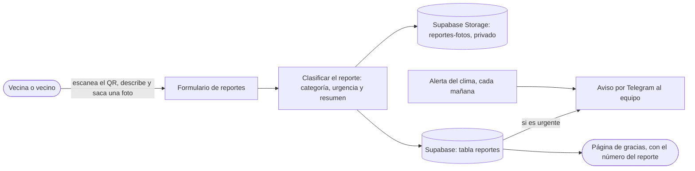

# Reportes ambientales con foto

Un formulario público para reportar basura, quemas, agua o árboles con una foto: la IA clasifica cada reporte por tipo y urgencia, Supabase lo guarda y n8n avisa si es urgente. Con el workflow `67-reportes-ambientales`.

| De un vistazo | |
|---|---|
| **Para quién es** | Para equipos de la línea [Impacto social y ambiental](../lineas/impacto.md) que quieren un sistema de reportes andando rápido, sin armarlo pieza por pieza. Si preferís entender cada pieza, mirá la guía [07](07-impacto-ambiental-o-social.md). |
| **Qué vas a lograr** | Un formulario con foto que se abre desde un QR, una tabla `reportes` que se llena sola con categoría, urgencia y resumen, las fotos guardadas en privado y un aviso por Telegram para los reportes urgentes. |
| **Tiempo estimado** | 1 a 2 horas; 1 hora más con el aviso por Telegram y la alerta del clima. |
| **Qué necesitás** | Tu n8n ([guía 01](../00-empezar/01-cuenta-n8n-cloud.md)), un proyecto de Supabase ([guía 04](../00-empezar/04-cuenta-supabase.md)) y una clave de Gemini ([guía 07](../00-empezar/07-clave-gemini.md)). Para el aviso, un bot de Telegram (opcional). Y una respuesta: ¿quién recibe los reportes? |
| **Workflows** | [`67-reportes-ambientales`](https://github.com/nodo-cero-bo/workflows/tree/main/60-casos-de-uso/67-reportes-ambientales) · [`60-alerta-del-clima`](https://github.com/nodo-cero-bo/workflows/tree/main/60-casos-de-uso/60-alerta-del-clima) · opcional: [`66-bot-de-telegram-con-ia`](https://github.com/nodo-cero-bo/workflows/tree/main/60-casos-de-uso/66-bot-de-telegram-con-ia), [`52-traducir-y-resumir`](https://github.com/nodo-cero-bo/workflows/tree/main/50-google-cloud/52-traducir-y-resumir) y [`16-fuji-eventos-contrato`](https://github.com/nodo-cero-bo/workflows/tree/main/10-avalanche-fuji/16-fuji-eventos-contrato) |

Palabras de esta guía, explicadas con un ejemplo en el [glosario](../glosario.md): [base de datos](../glosario.md#base-de-datos), [RLS](../glosario.md#rls), [clasificar](../glosario.md#clasificar), [URL de producción](../glosario.md#url-de-prueba-y-url-de-producción) y [credencial](../glosario.md#credencial).

## La idea

La sede de la hackathon es el Centro de Educación Ambiental de Santa Cruz. Mucha gente ve un microbasural, una quema o una cañería rota y no sabe a quién avisar, o avisa por un chat donde el mensaje se pierde. Un buen sistema de reportes recibe fácil, ordena por su cuenta y no pierde nada.

Antes de construir, definan en equipo **quién recibe los reportes y qué hace con ellos**: una junta vecinal, una organización ambiental, un centro de estudiantes. Sin esa respuesta, el sistema junta datos que nadie mira.

## Pasos

### 1. Prepará la tabla y el lugar de las fotos

1. En tu proyecto de Supabase, abrí el **SQL Editor**.
2. Abrí el archivo [`supabase/sql/02_reportes.sql`](https://github.com/nodo-cero-bo/workflows/blob/main/supabase/sql/02_reportes.sql) del repo de workflows, copialo entero, pegalo y tocá **Run**.

**Qué vas a ver:** el mensaje de que la consulta corrió sin errores. El archivo crea la tabla `reportes` y un bucket privado de Supabase Storage, `reportes-fotos`, para fotos JPG, PNG o WEBP de hasta 5 MB. Está todo comentado: vale la pena leerlo.

**Cómo sabés que funcionó:** en **Table Editor** aparece `reportes`, vacía, y en **Storage** aparece el bucket `reportes-fotos`.

La guía de proyecto [Impacto ambiental o social](07-impacto-ambiental-o-social.md) usa esta misma tabla: si ya corriste el SQL con esa guía, correrlo otra vez no cambia nada (deja como está lo que ya existe). Eso sí, elegí un camino por proyecto de Supabase: si dejás andando también el Database Webhook de esa guía, cada reporte del 67 se clasifica dos veces.

La tabla tiene RLS activado y ninguna regla: con la clave publicable nadie puede leer ni escribir, y n8n entra con la clave secreta. Las fotos no tienen enlace público, porque una foto de la calle puede mostrar caras, patentes o casas.

### 2. Importá el workflow y conectalo

1. Importá [`67-reportes-ambientales`](https://github.com/nodo-cero-bo/workflows/tree/main/60-casos-de-uso/67-reportes-ambientales) ([cómo importar](../00-empezar/02-importar-workflows.md)) y leé la nota grande de la izquierda.
2. Conectá las credenciales:

   | Nodo | Credencial |
   |---|---|
   | **Modelo Gemini** | **Google Gemini(PaLM) Api**, con tu clave de AI Studio ([guía 07](../00-empezar/07-clave-gemini.md)) |
   | **Subir la foto** | **Supabase API** ([guía 04](../00-empezar/04-cuenta-supabase.md#3-creá-la-credencial-supabase-api-en-n8n)) |
   | **Guardar el reporte** | **Supabase API**, la misma |

3. Abrí **Subir la foto** y, en la **URL**, cambiá `TU-PROYECTO` por el identificador de tu proyecto: es lo que va antes de `.supabase.co` en el **Host** de tu credencial.

**Qué vas a ver:** dos caminos de entrada a la izquierda (**Formulario de reportes**, y **Al tocar Execute** con **Reporte de ejemplo**) que se juntan en **Preparar el reporte**. Después siguen **Clasificar el reporte**, **Ordenar la respuesta de la IA**, **¿Trae foto?**, **Subir la foto**, **Guardar el reporte**, **¿Es urgente?** y el final. El nodo **Avisar al equipo por Telegram** aparece gris: está apagado a propósito.

**Cómo sabés que funcionó:** ningún nodo muestra el aviso de credencial, salvo el de Telegram, que todavía no hace falta.

### 3. Probalo con el reporte de ejemplo

1. Mirá el botón de abajo del canvas. Como este workflow tiene dos disparadores, dice **Execute workflow from** y el nombre de uno. Si no dice **Execute workflow from Al tocar Execute**, abrí la flechita del costado y elegí **Al tocar Execute** ([por qué](../00-empezar/02-importar-workflows.md#después-de-importar-credenciales-datos-y-una-prueba)).
2. Tocá el botón.

**Qué vas a ver:** los nodos en verde. **Reporte de ejemplo** trae un reporte inventado, sin foto: basura quemada en un canal, con humo al lado de una escuela. Como no trae foto, **¿Trae foto?** lo manda directo a **Guardar el reporte**.

**Cómo sabés que funcionó:** en Supabase, **Table Editor**, `reportes` tiene una fila nueva con `origen` en `prueba`, su `categoria`, su `urgencia` y un `resumen` de una frase. Con fuego y humo cerca de una escuela, lo esperable es `quema` y `alta`: lo decide la IA, así que mirá qué eligió.

### 4. Mandá un reporte con foto desde el formulario

1. Tocá **Publish** en el encabezado del canvas y confirmá.
2. Abrí **Formulario de reportes** y copiá la **Production URL**. Abrila en tu celular.
3. Completá **¿Qué pasa?**, **¿Dónde?** (un barrio o una referencia, nunca la dirección de una casa) y, en **Foto (opcional)**, una foto sin caras ni patentes. Envialo.

**Qué vas a ver:** la **Página de gracias**: «Quedó guardado con el número...», con la categoría y la urgencia que le puso la IA.

**Cómo sabés que funcionó:** la fila nueva tiene `origen` en `formulario` y `foto_ruta` con el nombre de la foto, y en **Storage**, dentro de `reportes-fotos`, está la foto en una carpeta con la fecha de hoy.

4. Mandá dos o tres reportes más, distintos (una bolsa de basura en una esquina, una canilla que pierde agua en una plaza), y mirá cómo cambia la urgencia.

### 5. Entendé cómo decide la IA

1. Abrí **Clasificar el reporte** (un Information Extractor): tiene tres atributos, `categoria`, `urgencia` y `resumen`. La descripción de cada uno es la instrucción para la IA: ahí están las categorías posibles (`basura`, `quema`, `agua`, `arboles`, `animales`, `ruido`, `otro`) y qué cuenta como urgente.
2. Abrí **Ordenar la respuesta de la IA**: si la IA escribe distinto (`Basura`, `árboles`) o algo fuera de la lista, este paso lo deja en una opción válida (`otro` o `media`). Así la base nunca rechaza un reporte.

Si tu proyecto es de otro tema (salud, accesibilidad, escuela), las categorías se cambian en tres lugares, con las mismas palabras: la descripción de `categoria` en **Clasificar el reporte**, la lista `CATEGORIAS` en **Ordenar la respuesta de la IA** y la regla `check` de la columna `categoria` en la tabla.

**Cómo sabés que funcionó:** un reporte de prueba de tu tema sale con la categoría que esperabas.

### 6. Prendé el aviso por Telegram (opcional)

Los reportes con urgencia `alta` pueden avisarle al equipo al instante:

1. Creá un bot de Telegram como explica [`66-bot-de-telegram-con-ia`](https://github.com/nodo-cero-bo/workflows/tree/main/60-casos-de-uso/66-bot-de-telegram-con-ia) y sumalo al grupo de quien atiende los reportes.
2. Abrí **Avisar al equipo por Telegram**, cargá la credencial **Telegram API** y poné el **Chat ID** del grupo en lugar de `TU_CHAT_ID`.
3. Cerrá la ventana, seleccioná el nodo y prendelo con la tecla `D`. Publicá de nuevo.

**Cómo sabés que funcionó:** mandá un reporte urgente desde el formulario y el grupo recibe «Reporte urgente n.º...», con la categoría, el resumen y el lugar.

### 7. Sumá la alerta del clima

Las quemas y el calor van juntos. Que el mismo grupo reciba, cada mañana, el pronóstico de su zona:

1. Importá [`60-alerta-del-clima`](https://github.com/nodo-cero-bo/workflows/tree/main/60-casos-de-uso/60-alerta-del-clima). No pide ninguna credencial.
2. En **Dónde y cuándo avisar**, revisá la ciudad, la latitud y la longitud, y los límites (`calor_maximo_c`, `lluvia_mm`, `probabilidad_lluvia`).
3. Para ver cómo se ve una alerta un día lindo, cambiá `simular` a `calor` o `lluvia`, tocá **Execute workflow** y volvé a ponerlo en `no`.

**Cómo sabés que funcionó:** con `simular` en `calor`, el workflow arma un mensaje de alerta; con `no`, depende del pronóstico real.

### 8. Armá el QR para la demo y para el barrio

1. Con la **Production URL** del formulario, armá un código QR.
2. Imprimilo o mostralo en pantalla: es la puerta de entrada de todo el sistema.

**Cómo sabés que funcionó:** alguien que no es del equipo escanea el QR, manda un reporte y aparece en la tabla.

Hacelo tuyo: ideas para sumar

- **El resumen del día**: un workflow con un **Schedule Trigger** (por ejemplo, a las 18:00) que lee los reportes del día y arma un resumen por tipo, urgencia y lugar. Hay un ejemplo en el [paso 4 de la guía 07](07-impacto-ambiental-o-social.md#4-el-resumen-del-día).
- **En otros idiomas**: el aviso traducido al guaraní o al quechua con [`52-traducir-y-resumir`](https://github.com/nodo-cero-bo/workflows/tree/main/50-google-cloud/52-traducir-y-resumir) ([guía 09](09-traducir-y-resumir-con-google-cloud.md)), con revisión de una persona hablante.
- **El estado del reporte**: que quien atiende cambie `estado` a `en_revision` o `resuelto`, y una página pública muestre los números del mes. El SQL trae comentado cómo mostrar nada más los datos que no son sensibles.
- **Reportes que nadie puede borrar**: registrá cada reporte en un contrato propio en Fuji y leelo con [`16-fuji-eventos-contrato`](https://github.com/nodo-cero-bo/workflows/tree/main/10-avalanche-fuji/16-fuji-eventos-contrato), siguiendo la [guía 06](06-tu-contrato-en-fuji.md).
- **Que la IA mire la foto**: sumale a la clasificación la imagen del reporte, para confirmar si hay fuego o basura.

## Cómo presentarlo en la demo

1. **El problema, con una situación concreta**: una quema en un lote baldío y nadie sabe a quién avisar.
2. **La solución**: reportar en treinta segundos desde el celular, y que el sistema ordene y avise.
3. **Demo en vivo**:
   - Mostrá el QR y pedí que alguien del público mande un reporte con una foto de la sala (sin caras).
   - Con la tabla de Supabase proyectada, mostrá cómo entra el reporte con la categoría, la urgencia y el resumen que puso la IA.
   - Mostrá la **Página de gracias** en el celular y, si lo prendiste, el aviso que llega por Telegram.
   - Si sumaste el clima, mostrá la alerta con `simular` en `calor`.
4. **Qué sigue**: quién recibiría los reportes de verdad y qué haría falta para que los use.

Cargá antes algunos reportes inventados, para que la tabla no arranque vacía, y tené una ejecución exitosa guardada en **Executions** por si la red falla.

## Si algo falla

| Lo que ves | Qué probar |
|---|---|
| **Guardar el reporte**: «relation "public.reportes" does not exist» | Falta correr `02_reportes.sql` (paso 1). |
| `permission denied` (error `42501`) | Corré de nuevo el SQL completo: incluye los permisos que necesita la clave secreta. |
| **Subir la foto** falla | Revisá que hayas cambiado `TU-PROYECTO` en la URL y que la foto sea JPG, PNG o WEBP de menos de 5 MB. |
| **Execute workflow** abre el formulario en vez de usar el reporte de ejemplo | El botón estaba en **Execute workflow from Formulario de reportes**. Abrí la flechita del costado y elegí **Al tocar Execute**, o completá el formulario de prueba que se abrió. |
| El formulario anda en el editor pero no desde el celular | El workflow tiene que estar publicado y el QR, con la **Production URL** (`/form/`), no la de prueba (`/form-test/`). |
| Telegram responde `chat not found` | El **Chat ID** no es el del grupo, o el bot no está en el grupo. Revisalo con el workflow 66. |
| Error `429` en la IA | Es el límite del nivel gratuito de Gemini por minuto. Esperá un momento entre reportes de prueba. |

## Para seguir

- La línea completa: [Impacto social y ambiental](../lineas/impacto.md).
- Documentación de Supabase: [Storage](https://supabase.com/docs/guides/storage), [Row Level Security](https://supabase.com/docs/guides/database/postgres/row-level-security) y [tablas](https://supabase.com/docs/guides/database/tables).
- Documentación de n8n: [n8n Form Trigger](https://docs.n8n.io/integrations/builtin/core-nodes/n8n-nodes-base.formtrigger/), [Information Extractor](https://docs.n8n.io/integrations/builtin/cluster-nodes/root-nodes/n8n-nodes-langchain.information-extractor/) y [Schedule Trigger](https://docs.n8n.io/integrations/builtin/core-nodes/n8n-nodes-base.scheduletrigger/).

---

[Guías de proyecto](README.md) · Anterior: [Traducí y resumí con Google Cloud](09-traducir-y-resumir-con-google-cloud.md) · Siguiente: [Banco de ideas](../ideas.md)
