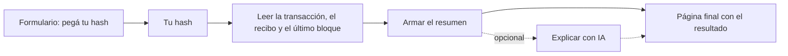

# Parte 7: Tu propio flujo

Juntá piezas de los workflows que ya probaste en uno nuevo: un formulario donde cualquiera pega el hash de una transacción de Fuji y ve, en una página, qué pasó. Y, si querés, una IA que lo explica en palabras simples.

| De un vistazo | |
|---|---|
| **Para quién es** | Para quien hizo las partes [2 a 6](02-tu-primer-workflow.md) y quiere armar algo propio sin empezar de cero. |
| **Qué vas a lograr** | Un workflow tuyo con un formulario público, la lectura de Fuji en el medio y una página final con el resultado. |
| **Tiempo estimado** | 45 minutos; 20 más con la explicación de la IA. |
| **Qué necesitás** | Los workflows de la [parte 5](05-el-desafio-del-dia.md) (`Leer una transacción en Fuji`) y, para la IA, el de la [parte 6](06-tu-agente-con-gemini.md) con tu credencial de Gemini. |

## La idea

Casi ningún proyecto se arma desde una hoja en blanco: se combinan piezas que ya funcionan. Este flujo toma tres:

| Pieza | De dónde sale |
|---|---|
| Un formulario que recibe un dato y muestra una página final | [`04-formulario`](https://github.com/nodo-cero-bo/workflows/tree/main/00-fundamentos/04-formulario) |
| La lectura de una transacción en Fuji | [`12-fuji-leer-transaccion`](https://github.com/nodo-cero-bo/workflows/tree/main/10-avalanche-fuji/12-fuji-leer-transaccion), de la parte 5 |
| Una IA que explica en palabras simples (opcional) | El modelo de [`05-agente-ia`](https://github.com/nodo-cero-bo/workflows/tree/main/00-fundamentos/05-agente-ia), de la parte 6 |



## Pasos

### 1. Duplicá el workflow de la parte 5

Así el original queda intacto, por si querés volver a él.

1. Abrí `Leer una transacción en Fuji`.
2. En el encabezado, abrí el menú **···** y elegí **Duplicate**.
3. Escribí el nombre `Mi verificador de transacciones` y confirmá con **Duplicate**.

**Qué vas a ver:** se abre la copia (puede ser en otra pestaña), con los mismos seis nodos.

**Cómo sabés que funcionó:** arriba dice `Mi verificador de transacciones`. Desde acá, todo lo que hagas es en la copia.

### 2. Sumá el formulario

1. Hacé clic derecho en una parte vacía del canvas y elegí **Add node** (o tocá el **+** de arriba a la derecha).
2. Buscá `form` y elegí **n8n Form Trigger**. Si n8n te muestra una lista de opciones, elegí la de trigger: la que arranca el workflow cuando alguien envía el formulario.

**Qué vas a ver:** se abre la ventana del nodo nuevo. En el canvas va a aparecer con el nombre **On form submission**.

3. Completá:

   | Campo | Qué poner |
   |---|---|
   | **Form Title** | `¿Qué pasó con mi transacción?` |
   | **Form Description** | `Pegá el hash de una transacción de Avalanche Fuji y te contamos qué pasó.` |
   | **Respond When** | **Workflow Finishes** (así el formulario espera el resultado para mostrarlo) |

4. En **Form Elements**, tocá **Add Form Element**:
   - En **Label**, escribí `Hash de la transacción`.
   - **Element Type** dejalo en **Text Input**.
   - Tocá **Add Attributes** y sumá **Custom Field Name**, con el valor `hash`, y **Required Field**, activado.

**Cómo sabés que funcionó:** al cerrar la ventana, **On form submission** está en el canvas, todavía sin conectar.

> [!TIP]
> **Custom Field Name** es el nombre con el que el dato llega al workflow. Si no lo encontrás, no pasa nada: el dato va a llegar con el nombre de la etiqueta, y en el paso 4 usás `{{ $json['Hash de la transacción'] }}` en vez de `{{ $json.hash }}`.

### 3. Conectá el formulario en lugar del botón

1. Hacé clic en **Al hacer clic en Probar** (el primer nodo) y borralo con la tecla `Supr` (o clic derecho, **Delete**).
2. Arrastrá desde el puntito de la derecha de **On form submission** hasta el puntito de la izquierda de **Tu hash**.
3. Si querés que quede prolijo, clic derecho en el canvas, **Tidy up workflow**.

**Cómo sabés que funcionó:** hay una línea que va de **On form submission** a **Tu hash**, y el resto de la fila sigue conectada como antes.

### 4. Que **Tu hash** use lo que llega del formulario

Hasta ahora, **Tu hash** tenía un hash fijo escrito a mano. Ahora tiene que tomar el que escribe la persona en el formulario: eso se hace con una expresión.

1. Abrí **Tu hash**.
2. Borrá el valor del campo `hash` y escribí:

   ```text
   {{ $json.hash }}
   ```

**Qué vas a ver:** el valor cambia de color: es una expresión. Todavía no muestra un resultado, porque el formulario no recibió nada. Es normal.

**Cómo sabés que funcionó:** el campo `hash` dice `{{ $json.hash }}`. Cerrá la ventana.

### 5. Sumá la página final

1. Tocá el **+** que aparece a la derecha de **Armar el resumen**.
2. Buscá `form` y elegí **n8n Form** (el que no es trigger).
3. En **Page Type**, elegí **Form Ending**. En **On n8n Form Submission**, dejá **Show Completion Screen**.
4. En **Completion Title**, pegá esta expresión:

   ```text
   {{ $json.encontrada ? 'Tu transacción, leída por n8n' : 'No encontramos esa transacción' }}
   ```

5. En **Completion Message**, pegá esta otra:

   ```text
   {{ $json.encontrada ? 'Estado: ' + $json.estado + '. Monto: ' + $json.montoAVAX + ' AVAX. Bloque: ' + $json.bloque + '. <a href="' + $json.explorador + '" target="_blank">Verla en el explorador</a>' : $json.mensaje }}
   ```

Si al pegar el texto no cambia de color, elegí **Expression** (en vez de **Fixed**) arriba a la derecha del campo y pegalo de nuevo.

Las dos usan la forma `condición ? 'si se cumple' : 'si no'`: si la transacción existe, muestran sus datos; si no, el mensaje que arma **Armar el resumen** con qué revisar.

**Cómo sabés que funcionó:** **Armar el resumen** está conectado al nodo nuevo, **Form**.

### 6. Probalo

1. Tocá **Execute workflow**.

**Qué vas a ver:** se abre una pestaña nueva con tu formulario de prueba, con el título y el campo que pusiste.

2. Pegá el hash de ejemplo y envialo:

   ```text
   0xe3f00c7d004c3219b867f2349e528be962712ea328b9e7007b233b58af655150
   ```

**Qué vas a ver:** unos segundos de espera y después tu página final: «Tu transacción, leída por n8n», con el estado, el monto (0.5 AVAX) y el enlace al explorador.

**Cómo sabés que funcionó:** la página muestra los datos y, de vuelta en n8n, todos los nodos están en verde.

3. Probá de nuevo con un hash inventado (`0x` y 64 unos) y con el tuyo, si lo tenés.

**Cómo sabés que funcionó:** con el inventado, la página dice «No encontramos esa transacción» y explica qué revisar.

### 7. Que la IA lo explique (opcional)

Para que cualquiera entienda el resultado, aunque nunca haya oído hablar de blockchain:

1. Tocá el **+** de la conexión entre **Armar el resumen** y **Form** (aparece al pasar el mouse por la línea) y elegí **Basic LLM Chain**.
2. En **Source for Prompt (User Message)**, elegí **Define below**, y en **Prompt (User Message)** pegá esto (en modo **Expression**, como en el paso 5):

   ```text
   Explicá en dos frases simples, en español con voseo, qué pasó en esta transacción de Avalanche Fuji, la red de prueba de Avalanche. Si no se encontró, explicá qué puede revisar la persona. Datos: {{ JSON.stringify($json) }}
   ```

3. Conectá un modelo en la entrada **Model** de **Basic LLM Chain**. Lo más rápido: abrí tu workflow de la parte 6, hacé clic en **Modelo Gemini**, copialo con `Ctrl` + `C`, volvé a este workflow, pegalo con `Ctrl` + `V` y conectalo a **Model**. Viaja con tu credencial ya elegida.
4. En **Form**, el texto de la IA llega en el campo `text`, y los datos de Fuji ya no son el item anterior. Cambiá el **Completion Message** por:

   ```text
   {{ $json.text }} <a href="{{ $('Armar el resumen').item.json.explorador }}" target="_blank">Verla en el explorador</a>
   ```

   y en el **Completion Title**, cambiá `$json.encontrada` por `$('Armar el resumen').item.json.encontrada`.

5. Probá otra vez con **Execute workflow**.

**Cómo sabés que funcionó:** la página final explica la transacción en dos frases, en español, y el enlace al explorador sigue andando.

### 8. Publicalo y compartilo

1. Tocá **Publish** en el encabezado del canvas y confirmá.
2. Abrí **On form submission** y copiá la **Production URL** (termina en una dirección con `/form/`).
3. Abrila en tu celular, o armá un código QR con ella para la demo.

**Cómo sabés que funcionó:** la URL abre el formulario aunque cierres el editor, y cada envío queda en **Executions**.

<details>
<summary>La misma receta, para otras líneas</summary>

El patrón «formulario, algo en el medio, página final» sirve para casi todo. Algunas combinaciones con piezas que ya conocés:

| Línea | Formulario | En el medio | Página final |
|---|---|---|---|
| Impacto social y ambiental | «¿En qué zona estás?» | El pedido del clima de [`03-http-request`](https://github.com/nodo-cero-bo/workflows/tree/main/00-fundamentos/03-http-request), con la latitud y la longitud de la zona | «Hoy hay 34 °C: tomá agua y buscá sombra» |
| IA para tu comunidad | «Contanos tu duda» | Un **Basic LLM Chain** con un mensaje de sistema sobre tu organización | La respuesta de la IA |
| Apps con login y datos | Los datos de un pedido | El nodo de Supabase de [`30-formulario-a-supabase`](https://github.com/nodo-cero-bo/workflows/tree/main/30-supabase/30-formulario-a-supabase) | «Recibimos tu pedido» |
| Web3 con Avalanche Fuji | Una dirección `0x` | El saldo de [`11-fuji-saldo-wallet`](https://github.com/nodo-cero-bo/workflows/tree/main/10-avalanche-fuji/11-fuji-saldo-wallet) | «Tu saldo en Fuji es de...» |

Para copiar nodos de un workflow a otro: seleccionalos, `Ctrl` + `C`, cambiá de workflow y `Ctrl` + `V`.

</details>

## Si algo falla

| Lo que ves | Qué probar |
|---|---|
| **Execute workflow** no abre el formulario | Revisá que **On form submission** esté conectado a **Tu hash** y que hayas borrado el trigger viejo. |
| La página final dice «No encontramos esa transacción» con un hash bueno | **Tu hash** no está recibiendo el dato. Abrí **Tu hash** en la ejecución y mirá su **Input**: el campo se tiene que llamar `hash`. Si se llama `Hash de la transacción`, usá la expresión del consejo del paso 2. |
| El formulario se queda cargando y no muestra nada | Revisá que **Respond When** diga **Workflow Finishes** y que **Form** esté conectado al final. |
| La página final muestra el texto de la expresión, sin calcular | El campo no está en modo expresión: borrá y pegá de nuevo, empezando con `{{`. |
| La IA no responde o da `429` | Revisá que el modelo esté conectado a **Model** y que tenga tu credencial de Gemini. Si es `429`, esperá un minuto. |
| La **Production URL** no anda | El workflow tiene que estar publicado (**Publish**). La URL de prueba (`/form-test/`) anda nada más mientras el editor espera. |

## Para seguir

- Siguiente: [Parte 8: Tu demo](08-tu-demo.md).
- Para que el flujo crezca: elegí tu [línea](../lineas/README.md) y una [guía de proyecto](../proyectos/README.md).
- Documentación oficial: [n8n Form Trigger](https://docs.n8n.io/integrations/builtin/core-nodes/n8n-nodes-base.formtrigger/), [n8n Form](https://docs.n8n.io/integrations/builtin/core-nodes/n8n-nodes-base.form/) y [Basic LLM Chain](https://docs.n8n.io/integrations/builtin/cluster-nodes/root-nodes/n8n-nodes-langchain.chainllm/).

---

[Tutorial](README.md) · Anterior: [Parte 6](06-tu-agente-con-gemini.md) · Siguiente: [Parte 8: Tu demo](08-tu-demo.md)
